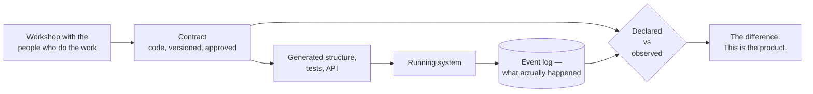

# PNS — a conformance engine

Answers one question:

> **Is the code your company runs still doing what the agreed process says it should?**

Not "does this module work" — tests answer that. Not "is the server up" — monitoring answers
that. The question nothing answers today is the third one: **an invoice that should have gone
out never did, and nothing failed**, because the code simply never ran. No alert fires. Every
dashboard stays green.

## How it works

A business process is declared as a **contract**: an Elixir module, written by developers,
approved by the person who owns the process, and versioned like any other code. The contract
is the one artifact everything else reads:

- it generates the module structure, the tests, and the surface an API may call
- it declares the graph of events a running system is allowed to emit
- it states assertions a log of what actually happened gets checked against — *"within 3 days
  of X, Y must happen, or else Z"*

The engine reads the contract twice: at compile time, to refuse code that contradicts it, and
at runtime, to compare the event log against what was declared. **The difference between the
two is the product.**



Think of it as a control loop: the contract is the setpoint, the event log is the measurement,
and the generated code in between is the plant — a black box on purpose. Nothing here inspects
it. You don't model the inertia of every piston to know an engine is running slow; you compare
the commanded pedal angle against the observed shaft speed.

A compliance screen built on top of this has **four questions and not one more**: which declared
paths have never been exercised, which transitions happened that were never declared, which
`trace` assertions are being violated right now, and which contract version is deployed, and
since when.

Everything else already has an owner. Performance is your APM's job. Errors are your error
tracker's job. **Business state is the client application's job.** The day this engine starts
answering "which company hasn't closed July," it has become a second, worse screen of that
application — and that is deliberately out of scope, see below.

## What's in this repository

The product is `packages/pns_core` — a self-contained Elixir package with its own `mix.exs`
and its own test suite (306 tests, none of them requiring a client application to exist).
That is the part meant to eventually ship as a Hex package.

**Everything else in this tree is test material**, kept on purpose so the engine's assumptions
get exercised against something other than its own imagination — and a contract that turns out
impossible to write against real material is treated as a *better* finding than one written
next to material that never pushed back:

- [`lib/taxvision/`](lib/taxvision) — a full, fictional client application: schemas, handlers, a
  repo, an API. Built to check whether a contract survives contact with a real-shaped domain.
- [`lib/rehmed/`](lib/rehmed) — **contracts only**, from a second, unrelated domain (healthcare),
  with zero handlers. Proof that the DSL generalizes across domains, without paying for a second
  full application.
- [`test/support/universality_gate/`](packages/pns_core/test/support/universality_gate) — a
  third, openly invented domain. It says so in its own first line.

The boundary between the engine and its test material is enforced by [`boundary`](https://hex.pm/packages/boundary)
from the first commit, so that separation is a fact the compiler checks, not a promise in a
document. Moving a client tree out of this repository is a `git mv` — confirmed by actually
doing it once, when the engine itself was extracted into `packages/pns_core`.

## Getting started

Requires Elixir `~> 1.18`, Erlang/OTP 27, and Docker (for Postgres).

```bash
docker compose up -d
mix deps.get
mix ecto.setup
mix check
```

`mix check` is the gate: `compile --force --warnings-as-errors`, `pns.check`, `pns.docs --check`,
this project's own tests, and — as a separate invocation — `packages/pns_core`'s test suite,
because the package is meant to build and test on its own, independent of any host application.
Postgres listens on `5433`, not the default `5432`, so the gate doesn't depend on whatever else
happens to be listening on a given machine.

`--warnings-as-errors` is load-bearing, not stylistic: `boundary` reports violations as
*warnings*, so without that flag module boundaries would be documentation rather than a check.

## Writing a contract

If you know `Ecto.Schema`, you already have the mental model. A schema declares the shape of
rows that are **stored**; a `PNS.Contract` declares the shape of facts that **happened**.

```elixir
defmodule MyApp.Contracts.CaseHandling do
  use PNS.Contract

  event :case_opened,
    label: "Case opened",
    payload: %{case_id: :id},
    process: :handling

  event :case_closed,
    label: "Case closed",
    payload: %{case_id: :id},
    process: :handling,
    terminal: true

  process :handling,
    label: "Case handling",
    instance: [:case_id]
end
```

That's the smallest contract that compiles. Everything else — `trace` assertions between events,
`external` dependencies named as business facts rather than vendors, and `rule`/`example` pairs
for the one place a decision actually gets made — is additive. The full key reference is
generated straight from the contract's own schema, so it cannot drift from the code that reads
it: see [`docs/contract.md`](docs/contract.md).

## Command line

```bash
mix pns.check                              # whole-program checks: back edges, competing
                                            # handlers, orphaned declarations, unverified claims
mix pns.graph                              # the static graph, from the compiled registry
mix pns.graph --overlay --mermaid          # observed graph: registry edges + counts from the log
mix pns.graph --mermaid --process <name>   # the declared shape of one process, from the
                                            # contract alone — no implementation required
mix pns.brief --process <name> --output brief.html  # a document for a client-facing review
mix pns.trace                              # trace assertions evaluated against the log —
                                            # counts, not a list of individual runs
mix pns.docs                               # regenerate the key reference in docs/contract.md
mix pns.report                             # the compliance report — four questions, one page
mix pns.report --since 2026-07-01T00:00:00Z --until 2026-07-31T23:59:59Z
```

### Two diagrams, for two different readers

Both come out of `mix pns.graph`, and they deliberately don't show the same thing:

| | For | Content comes from |
| --- | --- | --- |
| `--overlay --mermaid` | the engineering team | handler registry edges + counts from the event log |
| `--process <name> --mermaid` | **the process owner, before anything is built** | `stages`, `terminal`, `trace` and `depends_on` straight from the contract |

The second is the only one that says anything about a contract with no implementation yet: with
no handlers, the overlay view has zero edges, so it renders as disconnected boxes. Stages with
more than one event are labeled `no order claimed inside` on purpose — a contract that declares
little should render as a loose, honest picture, not as one tightened by inventing an order
nobody agreed to.

## Repository layout

```
packages/pns_core/            the engine — a standalone package, its own mix.exs and test suite
  lib/pns/
    contract.ex                DSL, compile-time gates, @before_compile, version/0
    handler.ex                  checks inside the macro body; publishes: also binds at runtime
    registry.ex                  boot-time scan of the compiled binary — the graph comes from
                                  code that actually runs, not from source that merely compiles
    emitter.ex                    emit/4: log write, sync handlers, jobs — one transaction boundary
    event.ex                       the event log and the handling log
    job.ex                          Oban worker, correlated across the process boundary
    instance.ex                     a run's identity from `instance:`, computed at emit time
    trace.ex                         per-run assertion evaluation — four verdicts
    dependency.ex                    unavailability observations for external dependencies
    conformance.ex                   the four compliance questions, as data
    deployment.ex                     a deployment's two identities: contract and boundary
    graph.ex                          static graph, observed overlay, declared-shape diagram
    brief.ex                          one process as a document for a human review session
    report.ex                         the compliance report — four questions, one page
    auth.ex                           the identity seam: a behaviour plus a local HMAC fake
    telemetry.ex                      the event catalogue: handler and contract-violation events
    migrations.ex                     the engine's own tables, versioned like Oban's
  lib/mix/tasks/                pns.check, pns.graph, pns.trace, pns.brief, pns.report, pns.docs
  test/                          the engine's own suite — stands without any client application
    support/universality_gate/       an invented domain, used only to prove the DSL generalizes
    support/process_shapes/          a bench for process shapes and mechanisms — not a domain

lib/taxvision/                 test material: a full client application
  contracts/                     one process, distilled from a real workshop
  api.ex                          the request edge: three IAM levels
  adapters/                       behaviour + fake

lib/rehmed/                    test material: contracts only, a second, unrelated domain
  contracts/                     three processes distilled from workshops, zero handlers

test/                          tests specific to the client trees above (periods, the identity
                               seam, contract examples, the declared-shape renderer)
docs/                          contract reference, starting assumptions, design rationale
```

## Deliberately out of scope

| | Why not |
| --- | --- |
| A dashboard, a screen | Had to confirm the difference between declared and observed was a signal worth showing before building a place to show it. It is — fifty runs collapse into one line of a report. |
| The observed-overlay graph, in a UI | Tried it: eleven events produced three edges, and the diagram said nothing a sorted list didn't already say. Doesn't apply to `--process`, which draws something else, for someone else — and for a contract with no implementation, it's the only view that says anything at all. |
| An opinion on the API layer | REST vs. GraphQL is an open question this project has no standing to close by building one. |
| `mix pns.new` | Worth building once something has been copied twice — i.e., at a second real client, not before. |
| Real registries, real mail, an OIDC provider | A behaviour plus a fake. The seam works; swapping the real implementation in is one line of configuration. |
| Alerts, ops dashboards, metrics collection | Performance is your APM's job, errors are your error tracker's job, business state is the client application's job. `PNS.Telemetry` is the seam other tools attach to — it emits only what nothing else can see: handler failures and contract violations. |
| Anything that answers a question about one specific company | The moment this engine can tell you "which company hasn't closed July," it has stopped being a compliance engine and started being a worse copy of the client's own application. |

## Where to go deeper

| Question | Read |
| --- | --- |
| How do I write a contract — required/optional keys, what refuses to compile | [`docs/contract.md`](docs/contract.md) |
| Why does the engine work this way — the starting assumptions, eighteen numbered decisions | [`docs/adr/architecture.md`](docs/adr/architecture.md) |
| What did each decision beat, which alternatives were rejected | [`docs/adr/design-rationale.md`](docs/adr/design-rationale.md) |
| Code shapes, schemas, library choices, implementation traps | [`docs/adr/technology-notes.md`](docs/adr/technology-notes.md) |
| Managing users, roles and access on a live sidecar | [`docs/identity-admin-guide.md`](docs/identity-admin-guide.md) |
| Project status, what's done, what came out of writing the code | `PLAN.md` — Polish, the running work log for this repository's contributors |
| Repository conventions | `CLAUDE.md` — Polish, for the same reason |

## Status

A working prototype, not a released library. The engine's own suite (306 tests) and the tests
specific to the two test-material trees (44 tests) both run in CI on every change; see
[`.github/workflows/ci.yml`](.github/workflows/ci.yml). Nothing here has shipped to a real client
yet — that is the next thing this repository is for.

## License

Apache License 2.0 — see [`LICENSE`](LICENSE).
