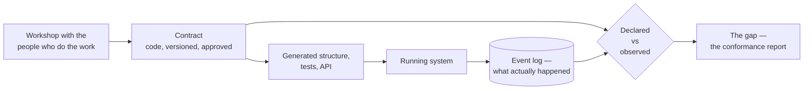

# eh_os_contract

[](https://github.com/EmpoweredHouse/eh-os-contract/actions/workflows/ci.yml)

**One contract per business process, and two things built on it: the plumbing an event-driven
Elixir application runs on, and a check — for as long as the system runs — that what actually
happened is what the contract says should.**

## Two halves, one contract

A process is written down as two Elixir modules, in the manner of [ESDM](https://www.esdm.io): a
**domain** — its words, contexts, actors and the systems it depends on — and a **contract** per process —
the units that decide, their commands, events and invariants, what reacts to them, what is read, and what
the process owner was promised. Both halves of the library read those modules and nothing else.

**Events.** `EhOsContract.dispatch/3` runs a command through the contract: it asks whether the actor may
issue it, checks its fields, reads the unit's history from the log, lets the implementation decide, and
appends what it decided — nothing the contract does not declare. The log is the engine's own, and the
state of a unit is its events, folded. What reacts to events is declared beside the units and runs where
its delivery says:

| Reaction | Runs | Use it for |
| --- | --- | --- |
| a read model or a policy, `:in_transaction` (their default within one context) | inside the dispatch transaction; if it raises, nothing is appended | projections and follow-up commands in the same database |
| a read model, a policy or a process manager, `:at_least_once` | fed from the log in order, after the commit, by a subscription that resumes where it stopped | whatever may lag the command |
| an effect, `:at_least_once` (its default, and the only way it runs when it `calls:` a system) | as an Oban job inserted **in the dispatch transaction** | anything with outside I/O: mail, HTTP, another system |
| an effect without `calls:`, `:in_transaction` | inside the dispatch transaction, after the policies | a side effect in the same database |

Every append takes one lock, held until its transaction commits, which is what keeps the log's order. So
whatever runs `:in_transaction` holds every other write in the application while it runs: keep it to the
database, and put anything slow behind `:at_least_once`.

A policy or an effect delivered at least once does not compile unless it names what makes a second
delivery harmless, because an event may be delivered more than once. A policy or a read model that reacts to an
event of another context does not compile until it says how it is delivered: run `:in_transaction`, a failure in
one part of the business undoes a fact recorded in another, so that has to be a choice the contract states, and
`mix eh_os_contract.check` warns of it.

**Conformance.** The same contract, compared against the log dispatch has been writing: which declared
steps never ran, what happened that nobody declared, which promises were broken, and which contract version
was deployed when.

## Between applications

Several applications can exchange events, each keeping its own log. An event leaves an application only
through a contract's `publish`: a relay reads the log in order and hands each published event to an
`EhOsContract.Bus`. A receiving application takes it into an inbox, deduplicated, and only a policy reacts to
it — another application's event never enters the receiver's log. A generated AsyncAPI document
(`EhOsContract.AsyncAPI`) describes what each application publishes, in the format a broker's tooling reads.

The library ships one bus, `EhOsContract.Bus.Local`, for tests and a single node, and depends on no broker. The
adapter for a real one (NATS JetStream) belongs to EHOS, the platform the applications run on.

Next is the DD programme — domain-driven design checked by code: each rule of the model that can be written
down gets something that checks it. Its stages are the GitHub issues labelled
[`dd`](https://github.com/EmpoweredHouse/eh-os-contract/issues?q=label%3Add).

## The question the conformance half answers

Tests tell you a module works. Monitoring tells you the server is up. Neither tells you the
thing a process owner actually wants to know: **is the running system still doing what we agreed
it would do?** An invoice that should have gone out, didn't. A case that should have been
escalated after three days, wasn't. Nothing threw, nothing paged anyone, every dashboard is
green — the code that should have run it just never fired.

## The idea

Declare the process once, as a **contract**: an Elixir module, written by developers, approved
by the person who owns the process, and versioned like any other code. Everything downstream
reads that one module and nothing else — the code structure, the tests, the API surface, the
graph of events the system is allowed to emit, and the assertions a log of what actually
happened will be checked against ("within 3 days of X, Y must happen, or else Z").

The library reads the contract twice: once at compile time, to refuse code that contradicts it,
and continuously at runtime, comparing the event log against what was declared. **The gap
between the two is what the conformance half reports.**



## Seeing it work

A process with one promise: a case is opened, and within three days it is either filed or explicitly
flagged for review.

```elixir
defmodule Acme.Contracts.InvoiceFiling do
  use EhOsContract.Contract, domain: Acme.Domain, context: :invoicing, id: "acme.invoice_filing"

  aggregate :case, "Case" do
    identity :case_id

    command :open_case, "Open a case", by: :clerk, emits: :case_opened
    command :file_invoice, "File the invoice", by: :clerk, emits: :invoice_filed
    command :flag_invoice, "Flag for manual review", by: :clerk, emits: :invoice_flagged

    event :case_opened, "Case opened"
    event :invoice_filed, "Invoice filed", terminal: true
    event :invoice_flagged, "Invoice flagged for manual review", terminal: true
  end

  process :invoice_filing, "Invoice filing" do
    correlate :case_id

    promise :invoice_follows_case do
      from :case_opened
      eventually :invoice_filed
      within {3, :day}
      or_else :invoice_flagged
    end
  end
end
```

A module implements the `case` aggregate, and a command goes through `EhOsContract.dispatch/3`. Over a
month, 40 cases were opened. 39 look completely uneventful — filed or flagged, no exceptions anywhere. One
didn't: a code path that should have flagged it never ran, for reasons that have nothing to do with this
library (a bug, a missed deploy, an edge case nobody tested). No error, so nothing paged anyone. This is
the part of what `mix eh_os_contract.report` prints for that month about the process, in the sentences it
prints — the header and the contract's version, deployed since when, come before it:

```
PROCESS: Invoice filing
  Runs in this period: 40.
  All agreed steps were carried out in this period.
  Rule: after "Case opened" within 3 days, "Invoice filed" follows, or else "Invoice flagged for manual review".
    BREACHED in 1 of 40 runs.
    Of those that were met, 2 runs reached the fallback ending, which conforms to the rule.

DRIFT
  None: nothing happened outside the agreement.
```

`BREACHED in 1 of 40 runs` is the conformance half on one line. It doesn't point at a stack trace, and it
doesn't say what the invoice was for — it says reality stopped matching what was agreed, once out of forty
times, and here's proof.

## The four questions

The conformance report, and the dashboard built on top of it, answers four questions —
deliberately, and not one more:

1. Which declared steps were never taken in this period?
2. What happened that was never declared — drift?
3. Which promises are being broken right now, and how often?
4. Which contract version is deployed, and since when?

For an aggregate that declares its lifecycle, the first two are asked of its transitions too: which
declared transitions no aggregate took, and which moves the lifecycle does not allow happened anyway.

Everything else already has an owner: performance is your APM's job, errors are your error
tracker's job, **business state is the client application's job.** The library helps build that state —
read models and queries are declared in the contract — but the dashboard never shows it. The day this library starts
answering "which customer's order hasn't shipped yet," it has become a second, worse screen of
that application — see [non-goals](#non-goals).

## Seeing the dashboard

The same four questions, as a screen instead of a report — [`packages/eh_os_contract_web`](packages/eh_os_contract_web),
mounted at `/dashboard` on this repository's sandbox host the way `oban_web` mounts into any Phoenix
app. Built only once `mix eh_os_contract.report`'s text output above had already proven the signal was worth
showing; the screen reformats that answer, it doesn't invent a second one. Two screens: contract
status (the four questions, per contract), and graph — a domain's context map, its system of contracts and
what flows between them, and each process's declared shape, over the log — the diagrams
`mix eh_os_contract.graph` draws, rendered live instead of piped to a file.

```bash
cd sandbox && mix phx.server
```

The same answers, and each contract's and domain's graph as a `graph.v1` document with what the log says
over it, are JSON for any other client — EHOS Console, CI — under the host's `/api` mount: the routes are in
[the web package's README](packages/eh_os_contract_web/README.md#the-api), and `mix eh_os_contract.graph --json`
writes the same documents to a file.

Then open `http://localhost:4010/dashboard`. There is no login: who may see the dashboard is the
host's decision, made through an `EhOsContract.Web.Resolver` it passes to the mount, and the sandbox
host lets everyone in read-only — nothing here belongs pointed at anything but your own machine.

## Writing a contract

If you know `Ecto.Schema`, you already have the mental model: a schema declares the shape of rows that
are **stored**, a contract declares the shape of facts that **happened** and of the decisions that produce
them. Both are declarations a machine reads, and both generate code you didn't write — here, a struct for
every command, event and state, and a behaviour for every piece of code that decides or reacts.

Beyond the example above: invariants, each with a scenario — given events, when a command, then events or
the refusal — that is also a test of the implementation; policies, effects and process managers; read
models and the queries that read them; `external` systems, named after the business fact rather than the
vendor, so a report can tell "we broke the rule" from "the system we depend on was down"; and personal
data, encrypted in the log per subject so that erasing a subject is deleting a key.

How to write a domain and a contract, and every refusal of the compiler by its code, is in
[`packages/eh_os_contract/docs/contract.md`](packages/eh_os_contract/docs/contract.md). Every key of both
DSLs is in a reference that is not hand-written: `mix eh_os_contract.docs`, run inside the package,
generates [`docs/dsl/`](packages/eh_os_contract/docs/dsl) from the DSLs themselves, and the package's gate
runs it with `--check`, failing the build if the two drift apart. A reference that can go stale is the
exact failure mode this project exists to catch in other people's systems, so it doesn't get to have one
of its own.

`mix eh_os_contract.graph` draws for two readers. `--process <name> --mermaid` is one process's declared
shape — its stages, where it ends, each promise as an arrow carrying its window — for the process owner,
before anything is built; `--contract` is a contract's full graph, its steps, actors, read side and external
systems; either with `--overlay` puts the log over it, for the team that runs it.

## Using it in your application

The packages install from git — see [`packages/eh_os_contract`](packages/eh_os_contract#installation)
for the engine (dependency, migration, configuration, the supervision-tree child) and
[`packages/eh_os_contract_web`](packages/eh_os_contract_web#installation) for the dashboard, and
[`packages/eh_os_contract_auth`](packages/eh_os_contract_auth#installation) for verifying EHOS credentials —
including [where the keys come from, and what to configure at integration](packages/eh_os_contract_auth#where-the-keys-come-from-and-what-to-configure-at-integration).

## Working on it

How work is planned, recorded and reviewed — issues, pull requests, where a decision is written down — is in
[`CONTRIBUTING.md`](CONTRIBUTING.md).

Requires Elixir `~> 1.18`, Erlang/OTP 27, and Docker (for Postgres).

```bash
docker compose up -d
cd sandbox
mix deps.get
mix ecto.setup
mix check
```

`mix check` in `sandbox/` is the gate: formatting, `compile --force --warnings-as-errors`,
`eh_os_contract.check` and the sandbox's own tests, then each package's own `mix check` as a
separate project — the engine's includes `eh_os_contract.docs --check` and `eh_os_contract.rules --check`. `--warnings-as-errors`
matters because `boundary` reports module-boundary violations as warnings, so without that flag the
boundaries below would be documentation rather than a check.

| Task | Does |
| --- | --- |
| `mix eh_os_contract.check` | whole-program checks over the contracts and their implementations, each finding under a stable name |
| `mix eh_os_contract.report --since … --until …` | the conformance report for a period |
| `mix eh_os_contract.graph --process <name> --mermaid [--overlay]` | one process's declared shape, no code required; with `--overlay`, its contract's full graph over the log |
| `mix eh_os_contract.graph --contract <Module> [--overlay] [--unit <name> \| --lifecycle <name>]` | a contract's full graph — steps, actors, read side, external systems — one unit of it, or an aggregate's lifecycle (with `--overlay`, the report's counts on its transitions) |
| `mix eh_os_contract.graph --map <domain>` / `--system <domain> [--overlay]` | a domain's context map, or its contracts and what flows between them |
| `mix eh_os_contract.view` / `glossary` / `pages` | the domain as a tree, its ubiquitous language, or Markdown pages, one per element |
| `mix eh_os_contract.subscriptions` | where each subscription stands, and a way past a poison event |
| `mix eh_os_contract.rewrap` | rewraps the subjects' data keys with the vault's current master key |
| `mix eh_os_contract.docs` / `rules` | inside `packages/eh_os_contract` only: regenerate `docs/dsl/` and `docs/rules.md` |
| `mix eh_os_contract.manifest --output <file>` | from `eh_os_contract_auth`: the EHOS application manifest, `ehos.yaml` extended with what the contracts offer |

## The repository

| Directory | What |
| --- | --- |
| [`packages/eh_os_contract`](packages/eh_os_contract) | **the library** — the domain and contract DSLs, dispatch, the event store, conformance, [`docs/contract.md`](packages/eh_os_contract/docs/contract.md) |
| [`packages/eh_os_contract_web`](packages/eh_os_contract_web) | the mountable dashboard |
| [`packages/eh_os_contract_auth`](packages/eh_os_contract_auth) | connects an application to EHOS: verifies its credentials against keys kept in the application's database, signs a person in through EHOS, and writes the application manifest |
| [`packages/eh_os_contract_graph`](packages/eh_os_contract_graph) | draws a contract's or a domain's `graph.v1` document in a LiveView, for the dashboard and the EHOS Console; depends on no other package here (in progress, plan E13b) |
| [`sandbox`](sandbox) | a host application around the packages, with the test material below |
| [`docs`](docs) | the starting assumptions (`docs/adr/`), distillations of the test material, and workshop material |

The library is a self-contained Elixir package with its own `mix.exs` and its own test suite, none
of it requiring a client application to exist. That is the part meant to eventually ship to Hex.

[`packages/eh_os_contract_web`](packages/eh_os_contract_web) ships alongside it — the dashboard from
[above](#seeing-the-dashboard), structured the same way `oban_web` sits beside `oban`: a mountable
router and screens, own `mix.exs`, own test host, no opinion about a host's own domain.

The sandbox — `sandbox/lib/taxvision/`, `sandbox/lib/rehmed/` and `sandbox/lib/appunite_equipment/`, the
domains, contracts and implementations of three unrelated businesses, accounting, healthcare and a company's
equipment — is test material and the library's first consumer, kept around so the library's assumptions get exercised against something other than its own
imagination. [`boundary`](https://hex.pm/packages/boundary) enforces the line between the two
from the first commit, so it's a fact the compiler checks, not a promise in a document.

## Non-goals

| | Why not |
| --- | --- |
| An opinion on the API layer | REST vs. GraphQL is an open question this project has no standing to close by building one. |
| A project generator (`mix eh_os_contract.new`) | Worth building once something has been copied twice — at a second real client, not before. |
| Real registries, real mail | A behaviour plus a fake. Real integrations are the client's domain cost and carry no signal for the library. |
| Identity: accounts, roles, sign-in screens | The library takes an actor as an opaque subject with the capabilities and scopes its verified credential grants; EHOS derives those from the contract's `by:` through the application manifest, and only a `:system` actor is checked against `by:` directly. EHOS owns accounts and its own sign-in screens: `eh_os_contract_auth` verifies EHOS's credentials and hands a person to EHOS to sign in, and access to the dashboard is decided by the host that mounts it. |
| A message broker | The library defines a bus and ships a local one; the adapter for a real broker belongs to EHOS. |
| Alerts, ops dashboards, metrics collection | Performance is your APM's job, errors are your error tracker's job, business state is the client application's job. |
| Anything that answers a question about one specific customer | The moment this library can tell you "which customer's order hasn't shipped yet," it has stopped checking conformance and started being a worse copy of the client's own application. |

## Learn more

| Question | Read |
| --- | --- |
| How do I write a domain and a contract, and what will not compile | [`packages/eh_os_contract/docs/contract.md`](packages/eh_os_contract/docs/contract.md) |
| Every key of both DSLs, generated from the code | [`packages/eh_os_contract/docs/dsl/`](packages/eh_os_contract/docs/dsl) |
| The second DSL, and what it reverses in the first | [`docs/adr/contract-v2.md`](docs/adr/contract-v2.md) |
| Why does the library work this way — eighteen starting decisions (written under its earlier name, `pns`) | [`docs/adr/architecture.md`](docs/adr/architecture.md) |
| What did each decision beat, which alternatives were rejected | [`docs/adr/design-rationale.md`](docs/adr/design-rationale.md) |
| Code shapes, schemas, library choices, implementation traps | [`docs/adr/technology-notes.md`](docs/adr/technology-notes.md) |

## Status

A working prototype, not a released library — nothing here has shipped to a real client yet.
The full test suite runs in CI on every pull request that changes code once it is ready for review — a draft
waits until it is marked ready (see the badge above); one that changes only the team's working documents skips
it. Licensed under
[Apache 2.0](LICENSE).
