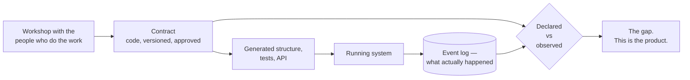

# PNS

[](https://github.com/EmpoweredHouse/eh-os-prototype/actions/workflows/ci.yml)

**A conformance engine: it turns a business process into code, and then keeps checking the two
against each other for as long as the system runs.**

## The question nothing else answers

Tests tell you a module works. Monitoring tells you the server is up. Neither tells you the
thing a process owner actually wants to know: **is the running system still doing what we agreed
it would do?** An invoice that should have gone out, didn't. A case that should have been
escalated after three days, wasn't. Nothing threw, nothing paged anyone, every dashboard is
green — the code that should have run it just never fired.

## The idea

Declare the process once, as a **contract**: an Elixir module, written by developers, approved
by the person who owns the process, and versioned like any other code. Everything downstream
reads that one module and nothing else — the code structure, the tests, the API surface, the
graph of events the system is allowed to emit, and the assertions a log of what actually
happened will be checked against ("within 3 days of X, Y must happen, or else Z").

The engine reads the contract twice: once at compile time, to refuse code that contradicts it,
and continuously at runtime, comparing the event log against what was declared. **The gap
between the two — not the generated code itself — is the product.**



## Seeing it work

A process with one rule: a case is opened, and within three days it must either be filed or
explicitly flagged for review.

```elixir
defmodule Acme.Contracts.InvoiceFiling do
  use PNS.Contract

  event :case_opened, label: "Case opened", payload: %{case_id: :id}, process: :invoice_filing
  event :invoice_filed, label: "Invoice filed", payload: %{case_id: :id},
    process: :invoice_filing, terminal: true
  event :invoice_flagged, label: "Invoice flagged for manual review", payload: %{case_id: :id},
    process: :invoice_filing, terminal: true

  process :invoice_filing, label: "Invoice filing", instance: [:case_id]

  trace :invoice_follows_case do
    from :case_opened
    eventually :invoice_filed, within: {3, :day}
    or_else :invoice_flagged
  end
end
```

Over a month, 40 cases were opened. 39 look completely uneventful — filed or flagged, no
exceptions anywhere. One didn't: a code path that should have flagged it simply never ran,
for reasons that have nothing to do with this engine (a bug, a missed deploy, an edge case
nobody tested). No error, so nothing paged anyone. This is the actual, unedited output of
`mix pns.report` for that month:

```
CONFORMANCE REPORT — 2026-07-01 – 2026-07-31
Whether the deployed code does what the agreed process says.

CONTRACT
  Version a1b2c3d, in force since 2026-06-02.

PROCESS: Invoice filing
  Runs in this period: 40.
  All agreed steps were carried out in this period.
  Rule: after "Case opened" within 3 days, "Invoice filed" follows, or else "Invoice flagged for manual review".
    BREACHED in 1 of 40 runs. (including 2 via the fallback ending, which conforms to the rule)

DRIFT
  None: nothing happened outside the agreement.
```

`BREACHED in 1 of 40 runs` is the whole product on one line. It isn't a bug report — it doesn't
point at a stack trace — and it isn't a business report — it doesn't say what the invoice was
for. It says one thing only: reality stopped matching what was agreed, on one run out of forty,
and here is proof.

## The four questions

That report, and any dashboard built on top of it, answers four questions — deliberately, and
not one more:

1. Which declared paths were never exercised in this period?
2. Which transitions happened that were never declared — drift?
3. Which `trace` assertions are being violated right now, and how often?
4. Which contract version is deployed, and since when?

Everything else already has an owner: performance is your APM's job, errors are your error
tracker's job, **business state is the client application's job.** The day this engine starts
answering "which company hasn't closed July," it has become a second, worse screen of that
application — see [non-goals](#non-goals).

## Writing a contract

If you know `Ecto.Schema`, you already have the mental model: a schema declares the shape of rows
that are **stored**, a `PNS.Contract` declares the shape of facts that **happened**. Both are
declarations a machine reads, and both generate functions you didn't write.

The example above is close to the smallest contract that compiles. Beyond it: `external`
dependencies, named after the business fact rather than the vendor, so a check can tell "we broke
the rule" from "the system we depend on was down"; and `rule`/`example` pairs for the one place
an actual decision gets made, so a decision function ships with a case that worked and a case
that went wrong — readable aloud, and executed by the test suite, not just documentation of it.

The full key reference — required keys, optional keys, what refuses to compile — lives in
[`docs/contract.md`](docs/contract.md), and it is not hand-written: `mix pns.docs` generates it
from `PNS.Contract.schema/0`, and `mix pns.docs --check` fails the build if anyone lets the two
drift apart. A DSL reference that can go stale is the exact failure mode this project exists to
catch in other people's systems, so it doesn't get to have one of its own.

Two diagrams come out of `mix pns.graph`, for two different readers, and they deliberately don't
show the same thing:

| | For | Content comes from |
| --- | --- | --- |
| `--overlay --mermaid` | the engineering team | handler registry edges + counts from the event log |
| `--process <name> --mermaid` | **the process owner, before anything is built** | `stages`, `terminal`, `trace` and `depends_on` straight from the contract |

The second is the only one that says anything about a contract with no implementation yet — with
no handlers wired up, the overlay view has zero edges and renders as disconnected boxes.

## Getting started

Requires Elixir `~> 1.18`, Erlang/OTP 27, and Docker (for Postgres).

```bash
docker compose up -d
mix deps.get
mix ecto.setup
mix check
```

`mix check` is the gate: `compile --force --warnings-as-errors`, `pns.check`, `pns.docs --check`,
and the test suite — `--warnings-as-errors` matters because `boundary` reports module-boundary
violations as warnings, so without that flag the boundaries below would be documentation rather
than a check.

```bash
mix pns.check                              # whole-program checks: back edges, competing
                                            # handlers, orphaned declarations, unverified claims
mix pns.graph --overlay --mermaid          # the observed graph: edges + counts from the log
mix pns.graph --mermaid --process <name>   # the declared shape of one process, no code required
mix pns.brief --process <name> --output brief.html  # a document for a client-facing review
mix pns.trace                              # trace assertions evaluated against the log
mix pns.report --since 2026-07-01T00:00:00Z --until 2026-07-31T23:59:59Z
mix pns.docs                               # regenerate docs/contract.md from the DSL itself
```

## The package

The product is [`packages/pns_core`](packages/pns_core) — a self-contained Elixir package with
its own `mix.exs` and its own 306-test suite, none of which requires a client application to
exist. That is the part meant to eventually ship to Hex.

Everything else in this repository — `lib/taxvision/` (a full fictional client application),
`lib/rehmed/` (contracts only, from a second, unrelated healthcare domain) — is test material,
kept around so the engine's assumptions get exercised against something other than its own
imagination. [`boundary`](https://hex.pm/packages/boundary) enforces the line between the two
from the first commit, so it's a fact the compiler checks, not a promise in a document.

## Non-goals

| | Why not |
| --- | --- |
| A dashboard, a screen | Had to confirm the declared/observed gap was a signal worth showing before building a place to show it. It is — fifty runs collapse into one line of a report. |
| The observed-overlay graph, in a UI | Tried it: eleven events produced three edges, and the diagram said nothing a sorted list didn't already say. Doesn't apply to the per-process view, which is the only one that says anything about a contract with no implementation yet. |
| An opinion on the API layer | REST vs. GraphQL is an open question this project has no standing to close by building one. |
| A project generator (`mix pns.new`) | Worth building once something has been copied twice — at a second real client, not before. |
| Real registries, real mail, a real OIDC provider | A behaviour plus a fake. The seam works; swapping the real implementation in is one line of configuration. |
| Alerts, ops dashboards, metrics collection | Performance is your APM's job, errors are your error tracker's job, business state is the client application's job. |
| Anything that answers a question about one specific company | The moment this engine can tell you "which company hasn't closed July," it has stopped being a compliance engine and started being a worse copy of the client's own application. |

## Learn more

| Question | Read |
| --- | --- |
| How do I write a contract — every key, required/optional, generated from the code | [`docs/contract.md`](docs/contract.md) |
| Why does the engine work this way — eighteen starting decisions | [`docs/adr/architecture.md`](docs/adr/architecture.md) |
| What did each decision beat, which alternatives were rejected | [`docs/adr/design-rationale.md`](docs/adr/design-rationale.md) |
| Code shapes, schemas, library choices, implementation traps | [`docs/adr/technology-notes.md`](docs/adr/technology-notes.md) |

## Status

A working prototype, not a released library — nothing here has shipped to a real client yet.
350 tests run in CI on every change (see the badge above). Licensed under [Apache 2.0](LICENSE).
