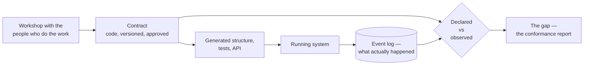

# eh_os_contract

[](https://github.com/EmpoweredHouse/eh-os-contract/actions/workflows/ci.yml)

**One contract per business process, and two things built on it: the plumbing an event-driven
Elixir application runs on, and a check — for as long as the system runs — that what actually
happened is what the contract says should.**

## Two halves, one contract

A contract is an Elixir module declaring the events a process consists of, what makes one run of
it, and what must follow what. Both halves of the library read that one module and nothing else.

**Events.** `EhOsContract.emit/4` refuses an event the contract does not declare, validates its
payload, and appends it to an event log. Reactions are handlers — `use EhOsContract.Handler` — and
the compiler refuses one for an undeclared event, or one that publishes an event it did not say it
would. Dispatch is split by the transaction boundary rather than by preference:

| Handler | Runs | Use it for |
| --- | --- | --- |
| synchronous (default) | inside the emitting transaction; if it raises, the event rolls back with it | writes to the same database |
| `async: true` | as an Oban job inserted **in the same transaction** — an outbox, without building one | anything with outside I/O: mail, HTTP, another system |

An asynchronous handler does not compile unless its event declares `identity:`, because the queue
delivers at least once and the event *will* arrive twice.

**Conformance.** The same contract, compared against the log that dispatch has been writing: which
declared paths never ran, which transitions nobody declared, which timed promises were broken,
and which contract version was deployed when.

## Where it is going

Today every application in this repository runs in one BEAM node against one Postgres. The next
step is several OTP applications side by side, exchanging events through a broker such as NATS
JetStream. The contract becomes the agreement *between* them — who publishes what, in which shape,
and what must follow — and a generated AsyncAPI document (`EhOsContract.AsyncAPI`) already
describes it in the standard format a broker's tooling reads. The shape this is expected to take:
each application keeps its own log and its own transactional outbox, and a relay publishes from
that outbox to the broker. **None of this is built yet.**

## The question the conformance half answers

Tests tell you a module works. Monitoring tells you the server is up. Neither tells you the
thing a process owner actually wants to know: **is the running system still doing what we agreed
it would do?** An invoice that should have gone out, didn't. A case that should have been
escalated after three days, wasn't. Nothing threw, nothing paged anyone, every dashboard is
green — the code that should have run it just never fired.

## The idea

Declare the process once, as a **contract**: an Elixir module, written by developers, approved
by the person who owns the process, and versioned like any other code. Everything downstream
reads that one module and nothing else — the code structure, the tests, the API surface, the
graph of events the system is allowed to emit, and the assertions a log of what actually
happened will be checked against ("within 3 days of X, Y must happen, or else Z").

The library reads the contract twice: once at compile time, to refuse code that contradicts it,
and continuously at runtime, comparing the event log against what was declared. **The gap
between the two is what the conformance half reports.**



## Seeing it work

Emitting is one call, and a reaction is a module:

```elixir
EhOsContract.emit(Acme.Contracts.InvoiceFiling, :case_opened, %{case_id: "c-42"}, %{actor: user_id})

defmodule Acme.Invoicing.OnCaseOpened do
  use EhOsContract.Handler,
    contract: Acme.Contracts.InvoiceFiling,
    event: :case_opened,
    publishes: [:invoice_filed]

  @impl EhOsContract.Handler
  def handle(%{case_id: case_id}, _ctx) do
    # ... file the invoice ...
    {:ok, [EhOsContract.event(:invoice_filed, %{case_id: case_id})]}
  end
end
```

The contract both of those are checked against — a process with one rule: a case is opened, and
within three days it must either be filed or explicitly flagged for review.

```elixir
defmodule Acme.Contracts.InvoiceFiling do
  use EhOsContract.Contract

  event :case_opened, label: "Case opened", payload: %{case_id: :id}, process: :invoice_filing
  event :invoice_filed, label: "Invoice filed", payload: %{case_id: :id},
    process: :invoice_filing, terminal: true
  event :invoice_flagged, label: "Invoice flagged for manual review", payload: %{case_id: :id},
    process: :invoice_filing, terminal: true

  process :invoice_filing, label: "Invoice filing", instance: [:case_id]

  trace :invoice_follows_case do
    from :case_opened
    eventually :invoice_filed, within: {3, :day}
    or_else :invoice_flagged
  end
end
```

Over a month, 40 cases were opened. 39 look completely uneventful — filed or flagged, no
exceptions anywhere. One didn't: a code path that should have flagged it never ran,
for reasons that have nothing to do with this library (a bug, a missed deploy, an edge case
nobody tested). No error, so nothing paged anyone. This is the actual, unedited output of
`mix eh_os_contract.report` for that month:

```
CONFORMANCE REPORT — 2026-07-01 – 2026-07-31
Whether the deployed code does what the agreed process says.

CONTRACT
  Version a1b2c3d, in force since 2026-06-02.

PROCESS: Invoice filing
  Runs in this period: 40.
  All agreed steps were carried out in this period.
  Rule: after "Case opened" within 3 days, "Invoice filed" follows, or else "Invoice flagged for manual review".
    BREACHED in 1 of 40 runs. (including 2 via the fallback ending, which conforms to the rule)

DRIFT
  None: nothing happened outside the agreement.
```

`BREACHED in 1 of 40 runs` is the conformance half on one line. It doesn't point at a stack trace,
and it doesn't say what the invoice was for — it says reality stopped matching what was agreed,
once out of forty times, and here's proof.

## The four questions

The conformance report, and the dashboard built on top of it, answers four questions —
deliberately, and not one more:

1. Which declared paths were never exercised in this period?
2. Which transitions happened that were never declared — drift?
3. Which `trace` assertions are being violated right now, and how often?
4. Which contract version is deployed, and since when?

Everything else already has an owner: performance is your APM's job, errors are your error
tracker's job, **business state is the client application's job.** The day this library starts
answering "which customer's order hasn't shipped yet," it has become a second, worse screen of
that application — see [non-goals](#non-goals).

## Seeing the dashboard

The same four questions, as a screen instead of a report — [`packages/eh_os_contract_web`](packages/eh_os_contract_web),
mounted at `/dashboard` on this repository's sandbox host the way `oban_web` mounts into any Phoenix
app. Built only once `mix eh_os_contract.report`'s text output above had already proven the signal was worth
showing; the screen reformats that answer, it doesn't invent a second one. Two screens: contract
status (the four questions, per contract), and graph, the same declared-shape and
declared-versus-observed Mermaid diagrams `mix eh_os_contract.graph` already drew, rendered live instead of
piped to a file.

```bash
cd sandbox && mix phx.server
```

Then open `http://localhost:4000/dashboard`. There is no login: who may see the dashboard is the
host's decision, made through an `EhOsContract.Web.Resolver` it passes to the mount, and the sandbox
host lets everyone in read-only — nothing here belongs pointed at anything but your own machine.

## Writing a contract

If you know `Ecto.Schema`, you already have the mental model: a schema declares the shape of rows
that are **stored**, an `EhOsContract.Contract` declares the shape of facts that **happened**. Both are
declarations a machine reads, and both generate functions you didn't write.

The example above is close to the smallest contract that compiles. Beyond it: `external`
dependencies, named after the business fact rather than the vendor, so a check can tell "we broke
the rule" from "the system we depend on was down"; and `rule`/`example` pairs for the one place
an actual decision gets made, so a decision function ships with a case that worked and a case
that went wrong — readable aloud, and executed by the test suite, not just documentation of it.

The full key reference — required keys, optional keys, what refuses to compile — lives in
[`packages/eh_os_contract/docs/contract.md`](packages/eh_os_contract/docs/contract.md), and it is not hand-written: `mix eh_os_contract.docs`, run inside the package,
generates it from `EhOsContract.Contract.schema/0`, and the package's gate runs it with `--check`, failing
the build if anyone lets the two drift apart. A DSL reference that can go stale is the exact failure mode this project exists to
catch in other people's systems, so it doesn't get to have one of its own.

Two diagrams come out of `mix eh_os_contract.graph`, for two different readers, and they deliberately don't
show the same thing:

| | For | Content comes from |
| --- | --- | --- |
| `--overlay --mermaid` | the engineering team | handler registry edges + counts from the event log |
| `--process <name> --mermaid` | **the process owner, before anything is built** | `stages`, `terminal`, `trace` and `depends_on` straight from the contract |

The second is the only one that says anything about a contract with no implementation yet — with
no handlers wired up, the overlay view has zero edges and renders as disconnected boxes.

## Using it in your application

Both packages install from git — see [`packages/eh_os_contract`](packages/eh_os_contract#installation)
for the engine (dependency, migration, configuration, the supervision-tree child) and
[`packages/eh_os_contract_web`](packages/eh_os_contract_web#installation) for the dashboard.

## Working on it

Requires Elixir `~> 1.18`, Erlang/OTP 27, and Docker (for Postgres).

```bash
docker compose up -d
cd sandbox
mix deps.get
mix ecto.setup
mix check
```

`mix check` in `sandbox/` is the gate: formatting, `compile --force --warnings-as-errors`,
`eh_os_contract.check` and the sandbox's own tests, then each package's own `mix check` as a
separate project — the engine's includes `eh_os_contract.docs --check`. `--warnings-as-errors`
matters because `boundary` reports module-boundary violations as warnings, so without that flag the
boundaries below would be documentation rather than a check.

| Task | Does |
| --- | --- |
| `mix eh_os_contract.check` | whole-program checks: back edges, competing handlers, orphaned declarations, unverified claims |
| `mix eh_os_contract.graph --overlay --mermaid` | the observed graph: edges and counts from the log |
| `mix eh_os_contract.graph --mermaid --process <name>` | the declared shape of one process, no code required |
| `mix eh_os_contract.brief --process <name> --output brief.html` | a document for a client-facing review |
| `mix eh_os_contract.trace` | trace assertions evaluated against the log |
| `mix eh_os_contract.report --since … --until …` | the conformance report for a period |
| `mix eh_os_contract.docs` | inside `packages/eh_os_contract` only: regenerate its `docs/contract.md` from the DSL itself |

## The repository

| Directory | What |
| --- | --- |
| [`packages/eh_os_contract`](packages/eh_os_contract) | **the library** — contract DSL, dispatch, event log, conformance, [`docs/contract.md`](packages/eh_os_contract/docs/contract.md) |
| [`packages/eh_os_contract_web`](packages/eh_os_contract_web) | the mountable dashboard |
| [`sandbox`](sandbox) | a host application around both, with the test material below |
| [`docs`](docs) | the starting assumptions (`docs/adr/`) and workshop material |

The library is a self-contained Elixir package with its own `mix.exs` and its own test suite, none
of it requiring a client application to exist. That is the part meant to eventually ship to Hex.

[`packages/eh_os_contract_web`](packages/eh_os_contract_web) ships alongside it — the dashboard from
[above](#seeing-the-dashboard), structured the same way `oban_web` sits beside `oban`: a mountable
router and screens, own `mix.exs`, own test host, no opinion about a host's own domain.

The sandbox — `sandbox/lib/taxvision/` (a full fictional client application), `sandbox/lib/rehmed/`
(contracts only, from a second, unrelated healthcare domain) — is test material and the library's first
consumer,
kept around so the library's assumptions get exercised against something other than its own
imagination. [`boundary`](https://hex.pm/packages/boundary) enforces the line between the two
from the first commit, so it's a fact the compiler checks, not a promise in a document.

## Non-goals

| | Why not |
| --- | --- |
| An opinion on the API layer | REST vs. GraphQL is an open question this project has no standing to close by building one. |
| A project generator (`mix eh_os_contract.new`) | Worth building once something has been copied twice — at a second real client, not before. |
| Real registries, real mail | A behaviour plus a fake. Real integrations are the client's domain cost and carry no signal for the library. |
| Identity: login, users, roles | The library takes an actor as an opaque subject and knows nothing else about who anybody is. Authentication belongs to the application that emits events, access to the dashboard to the host that mounts it. |
| Alerts, ops dashboards, metrics collection | Performance is your APM's job, errors are your error tracker's job, business state is the client application's job. |
| Anything that answers a question about one specific customer | The moment this library can tell you "which customer's order hasn't shipped yet," it has stopped checking conformance and started being a worse copy of the client's own application. |

## Learn more

| Question | Read |
| --- | --- |
| How do I write a contract — every key, required/optional, generated from the code | [`packages/eh_os_contract/docs/contract.md`](packages/eh_os_contract/docs/contract.md) |
| Why does the library work this way — eighteen starting decisions (written under its earlier name, `pns`) | [`docs/adr/architecture.md`](docs/adr/architecture.md) |
| What did each decision beat, which alternatives were rejected | [`docs/adr/design-rationale.md`](docs/adr/design-rationale.md) |
| Code shapes, schemas, library choices, implementation traps | [`docs/adr/technology-notes.md`](docs/adr/technology-notes.md) |

## Status

A working prototype, not a released library — nothing here has shipped to a real client yet.
The full test suite runs in CI on every change (see the badge above). Licensed under
[Apache 2.0](LICENSE).
