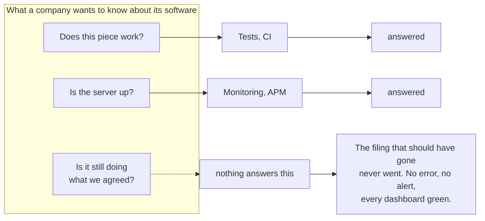
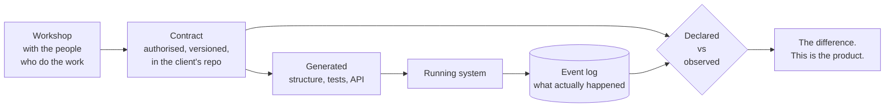
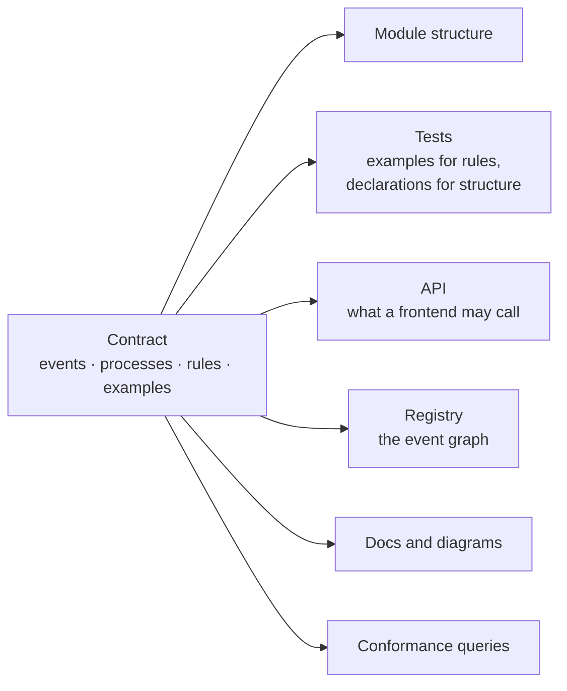
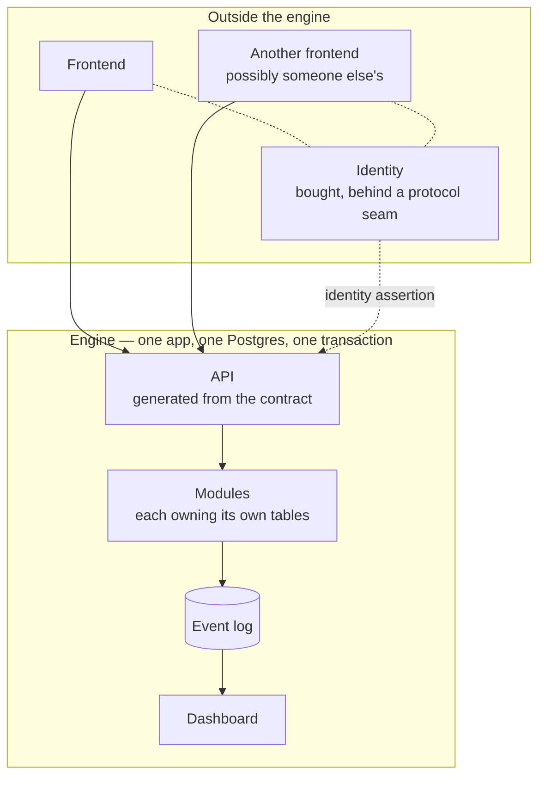

# PNS architecture — the starting assumptions

**This is what the engine was built to be, stated before it was built.** It is the premise this repository
validates, not a record awaiting anyone's acceptance: whether each assumption survives contact with code is
the question, and the answer accumulates in [`PLAN.md`](../../PLAN.md).

Read it to understand why a mechanism exists at all. Eighteen numbered decisions in thirteen entries — some
are pairs, `§5–6`, `§7–8`, `§9–10`, `§11–12`, `§16–17` — and `§N` is what a comment in `lib/pns/` points at
instead of restating the reasoning. Those references are the reason the numbering is stable and must stay so.

**Where this and `PLAN.md` disagree, `PLAN.md` is newer.** This document is deliberately behind: it says what
was assumed, and revising it every time code teaches something would destroy the only thing it is good for,
which is being comparable with what actually happened. Assumptions that turned out wrong are corrected here
and marked with the date, rather than quietly rewritten.

| If your question is | Read |
| --- | --- |
| Why does the engine work this way? What was assumed? | this file |
| What did each decision beat? Which alternatives were rejected? | [design rationale](design-rationale.md) |
| What do the code shapes, schemas and traps look like? | [technology notes](technology-notes.md) |
| How do I write a contract? | [contract reference](../contract.md) |
| What is done, what is next, what came out of building it | [`PLAN.md`](../../PLAN.md) |

Two things this file deliberately does not carry, because they belong to whoever decides rather than to
whoever builds: **who approved it and when**, and **the commercial scope**. Both live in the record in the
context repository, which is where a decision is made. Here it is a premise.

## Problem

**Nobody can tell whether the software a company runs still does what the company agreed it would
do — and when it stops, nothing fails.**

Companies run on software that does not match how they work, because bespoke software used to be too
expensive. AI changed that. But cheap code produces more code than anyone can read: nobody knows whether
what was built matches what was agreed, or what the next change breaks. And the business keeps
changing — a statute, a renegotiated contract, a new step, an exception that becomes the rule.

Our tools check the code, not the agreement. Tests say a module works. Review says the code looks sensible.
Monitoring says the server is up. None of them notice that an invoice which should have been filed was
never filed, because nothing failed — the code never ran.

The third question is the one nobody can answer, and it is the only one the client actually cares about.

**Not the problem: making generated code good.** That is a race between model vendors and we would lose it,
deservedly. Assume the code is cheap, plentiful, and of unknown quality — that is the premise, not the
complaint. The question is what you can still promise a company under that premise, and the answer is not
"the code is right". It is "you can see whether it is doing what you agreed, and you find out when it
isn't."

## The approach

A workshop turns the client's process into a contract. The contract generates the software and the tests.
Then the two are compared, continuously: what the contract says should happen against what the event log
recorded. **That difference is the product.**

The control loop in other words: the contract is the setpoint, the event log is the measurement, and the
generated code between them is the plant — **a black box on purpose.** Nothing here inspects it. Measuring
an engine does not mean modelling the inertia of every piston to derive angular velocity at the output; you
measure the commanded pedal angle and the observed shaft speed, and look at how the two curves sit against
each other.

Everything downstream reads one artifact, and none of it is edited:

What the client gets, in order: a **workshop** producing a process map, glossary and — for every rule — a
case that worked and a case that went wrong, in their language and agreed by them. A **contract** in their
repo. A **template** that already runs, and one command that deploys it. A **harness** of CI checks that
enforce the structure and teach it. **Generation** that is deterministic for structure and stochastic only
for decision functions, each written against a case the client already approved. And a **dashboard** where
declared meets observed: before a change ships you see what it affects, after it you see whether it works,
and the client sees where reality drifted.

## Decisions

Eighteen, numbered `§1`–`§18` across thirteen entries in five groups, to be proven on one bounded process
before anything is generalised. Each states what it commits to and what it beat; the argument behind each is
in [design rationale](design-rationale.md#why-each-decision).

### A. Workshop to running software

**1. The contract originates in a facilitated workshop, with the client in the room** — leaving with
**examples**, not only policies: per policy, one case that worked and one that went wrong, with real
numbers.
*Instead of:* generating from the workshop graph. Discovery-grade output carries no invariants, error paths
or types, so a generator invents them differently each run.

**2. The contract is code, in the client's repository.** One artifact is the compile-time registry, the
generation input, the source of tests and the reference for observed behaviour. Developers edit it, the
process owner approves its content, enforced with `CODEOWNERS`.
*Instead of:* a third-party documentation format as the source. Two editable representations of the same
thing diverge — the drift this product exists to detect, reproduced in our own toolchain.

**3. Generation is layered; only small parts are stochastic.** Contract reviewed by a human — the one
mandatory gate. Structure deterministic. Only decision functions go to a model, one at a time, each with
its test already present.
*Instead of:* one model pass over the whole application. A stochastic step without an acceptance criterion
is ordinary code generation with extra steps.

**4. Generated and hand-written code are physically separated**, and migrations are append-only.
*Instead of:* regenerating in place. Generated code is a fork the moment someone edits it.

### B. Runtime

**5–6. One Phoenix app, one Postgres, one module per process owning its own tables**, with `boundary`
enforcing it at compile time from the first commit. No cross-module joins and no views over another
module's tables. Duplicated data only where one copy is the named source of truth.
*Instead of:* umbrellas, which separate without enforcing, or services, which make transactional enqueue
impossible — and instead of one shared schema, which grows with every feature and forces edits to
functions that already worked.

Ownership is enforced in **CI, not at runtime** — deliberately, for now. See
[Review triggers](#review-triggers).

**7–8. Events are facts, commands are intentions, and the log of them is append-only, written in the state
change's transaction.** Every event carries `correlation_id`, `causation_id` and its contract version —
none of which can be retrofitted. The payload is declared in the contract, stored as JSON, and read
defensively. Retention persists by default. **The log lives with the client**, and its schema assumes
nothing about where it lives.
*Instead of:* CRUD-shaped mutations, which leave nothing to subscribe to or assert on — and instead of the
job table as the record, since a queue holds what was scheduled rather than what occurred.

*Corrected 26 September 2026, v2 plan E6, in the code that confirms it* ([contract v2](contract-v2.md)
§10–11, §18). For a v2 contract the log is not written in the state change's transaction: **the append is
the state change.** A unit's state is folded from its stream, `EhOsContract.dispatch/3` appends under the
stream's version, and read models are written in the append's transaction or after it. v1 contracts keep
working as the paragraph says until the cut (E11). Retention by default changes with crypto-shredding, in
E8.

*Corrected 27 September 2026, v2 plan E8* ([contract v2](contract-v2.md) §14). **Retention of a v2
contract's log is for ever, and personal data leaves it by crypto-shredding, not by deletion.** A field
declared `personal:` is sealed in the payload under its subject's data key; `EhOsContract.erase/3` deletes
the keys, records the erasure and appends `eh_os_contract.subject_erased`, and from then on the field reads
back as `EhOsContract.Erased`, while types, times, ids and every other field stay — so no conformance number
moves. A read model keeps its own copy in the host's tables and forgets it through `forget/2`. v1's
`retain:` (redacting or hashing a field as it is written) stays for v1 contracts until the cut, and v2 has
no `retain:`: `personal:` replaces it. "Volume handled by a purge job", in the table below, cannot hold
for the log since the append-only trigger of E2; what bounds its volume is open. Backups, WAL and replicas
keep a subject's wrapped key until they expire, which is the product owner's to weigh (§14).

**9–10. Dispatch is split by the transaction boundary, not by developer preference**, and idempotency is a
contract property — **the event declares which payload fields make two occurrences the same fact**, and the
key must include what distinguishes facts, not only what groups them. No external broker; `Phoenix.PubSub` and `GenStage` are rejected for anything the
contract asserts on, because both lose events silently.
*Instead of:* everything through Oban, which breaks read-after-write, or everything synchronous, where a
handler sending mail can roll back a business transaction.

*Corrected 26 September 2026, v2 plan E7* ([contract v2](contract-v2.md) §11–12, §18). **The split
survives, as a delivery on each consumer**: `:in_transaction` against `:at_least_once`. Handlers are gone;
what reacts is a read model (a projection), a policy (issues a command), a process manager (steers a run
with state and timers) or an effect (a side effect; one that calls an external system cannot run in the
transaction). Idempotency is still declared, on the consumer (`idempotency: :event_id`), with keys derived
from the event. What runs after the transaction is fed from the log in order by a subscription, not only by
jobs, so a read model after the transaction answers read-after-write through `min_position:` on a query.
**"No external broker" is still true** here; it changes with integration between applications (E12,
`docs/adr/contract-v2.md` §15–16), where a dated note will say so.

*Corrected 1 October 2026, v2 plan E12* ([contract v2](contract-v2.md) §16, D11–D12). **"No external
broker" holds inside one application only.** Between applications an event leaves through a `publish` and
`EhOsContract.Bus`, a behaviour whose transport adapters — JetStream through `gnat`, EHOS's relay — are
EHOS's; the library ships `EhOsContract.Bus.Local` for tests and one node, and depends on no broker. The
log is the outbox: a relay is one more ordered subscription, which advances only once the transport holds
the batch, so a message may come twice and never without its fact; `Bus` promises no order. A received
event goes to an inbox, never into the log, and only a policy takes it, in one transaction with the
inbox's row, acknowledged after the commit. Idempotency across the boundary is the publisher's
declaration, as this decision first had it for an event: `idempotent_on:` makes the message's key, and the
inbox takes a fact once when the publisher declares it, a delivery once in any case. What `Phoenix.PubSub`
and `GenStage` were rejected for still holds for the log: no fact is lost on the way to it, and a message
the bus does not deliver — to a consumer subscribed after it was published, past a transport's limit on
deliveries, through a restarted `Bus.Local` — leaves the publisher's log and the subscriber's as they were.

**11–12. External systems are adapters, the contract declares the dependency, and swapping is separate
from configuring.** Events are named after the business fact, never the vendor.
*Instead of:* calling vendors from domain code, after which a check cannot tell "we broke the rule" from
"the ministry was down" — for an accounting client, the whole question.

### C. Verification and method

**13. Three layers, each answering a different question.**

| Layer | Question | Where |
| --- | --- | --- |
| Contract | What is supposed to happen? | Agreed with the client |
| Unit tests | Does this piece work, and which piece is broken? | CI, generated from the contract |
| Event log | Is the live system still doing what was agreed? | Production |

One gap in the third layer, found by building it: a synchronous handler that raises rolls back its handling
row along with the event, so the most interesting failure leaves no trace in the artifact that exists to make
failures visible. Correct by the transaction rules and useless for diagnosis. Named in
[technology notes §4](technology-notes.md#4-delivery).

**Closed on 6 August, and closing it turned out to be a question for the first layer rather than the third.**
The failure is recorded and the rollback stands — recording it by weakening the rollback would have traded a
diagnosis gap for a log that claims a fact occurred when the work did not. It is a separate table with no
foreign key to the log, because there is nothing to reference: the event was rolled back and never existed, so
this row says *attempted and did not happen*, which is not a statement any other row in the log makes. What
survives a rollback is the correlation id, generated before the transaction opened.

The part worth carrying into the record is what the gap turned out to be about. A path whose handler crashes on
every run is reported by the conformance layer as **declared and never observed** — a dead contract or an
untested path, which is what §13's third layer is for. Both readings are false, and worse, they send a
developer's defect to the process owner as a question about their process. So the trace is not only for
diagnosis: the report needs it to tell *never attempted* from *attempted and failing*, and without it the
product's own output is wrong on its own terms. That is the third instance of one rule — after zero runs and
queued work — that a report must not turn *no answer* into *the answer is no*.

*Instead of:* tests as the whole verification story. A unit test cannot see an invoice that was never
filed, because nothing failed.

**14. The harness enforces structure, teaches the method, and stays out of modelling.** Knowledge is pushed
as far up the ladder as it will go — compiler error, then CI check, then generator default, then skill.
Whether something should be an event, or a module should split, is not enforced: those are workshop
judgements, and a linter with opinions about them gets disabled within a month. Decomposition is therefore
the first **skill**, built on modular design (`empowered-house-context/wiki/pns/modular-design.md`).
*Instead of:* a harness with opinions about modelling. A check that is sometimes wrong about a judgement
call costs more than the judgement call.

### D. What ships

**15. The contract knows about processes, not only events. Version one watches them; it does not steer
them.** *Provisional — see [Review triggers](#review-triggers).* A process is a row with a deadline, an
expected cadence and **a declared run identity**. When one derails, **a person decides**, and their decision
is issued as a command that emits events, so every exception becomes a recorded case.

*Corrected while building it.* "A row with a deadline and an expected cadence" was incomplete in both
halves. Run identity is missing and is not optional: `trace` asserts *after X, eventually Y*, and without
it a Y from someone else's run counts as satisfaction — so the assertion has nothing to stand on, and the
overlay counters hide the silence of every run but the loudest. It is declared as `instance:` on the
process and required. Cadence, in turn, is real but **not universal**: an event-driven process has none,
which the second-domain contract established. See
[technology notes §1](technology-notes.md#1-the-contract-and-the-code-it-governs).

*Corrected again 22 September 2026.* The second sentence — "their decision is issued as a command that
emits events" — described commands as something that happens **to** the contract rather than something
declared **in** it. A command is now a declaration of its own, the seventh: a name, the process it
enters, which kinds of principal may issue it, and its payload. The capability derives from it, which is
the whole reason it exists — a way into a process that not everybody may take.

Two things that shape carries, and neither was foreseeable from here. It has **no list of the events it
emits**, deliberately: the set the examples show and the set reachable through handlers are provably
different in this repository's own corpus, and no compile gate can check a set for completeness, only its
members. And the capability it derives answers one level of two — whether this *kind* of principal may
issue the command at all. Whether *this* principal may issue it *for this subject* stays a `rule` with a
decision function, and of the two commands that existed when this was measured, one had such a rule and
the other had no actor field anywhere. Neither level makes the other redundant.

A census run the same day found the shape of the gap this decision left: twenty-six events across the four
contracts are entered from outside and two had a command, because until now a command could only be
written as a side effect of writing a rule. See [PLAN.md](../../PLAN.md), "Dopisek 22 września", 5.5–5.6.

*Corrected 26 September 2026, v2 plan E6* ([contract v2](contract-v2.md) §5, §11, §18). "No list of the events
it emits" is reversed for a v2 contract: a command declares `emits:`, and the set is checked for membership
at compile time, where `emit/1` takes only events the command emits (I4), and at dispatch, where an event
outside it raises and nothing is appended. Completeness is still not checked, so the argument about sets
stands; v2 checks the half that can be checked. The first of the two levels is now the
`EhOsContract.Authorizer`'s question (D14). "For this subject" is `scope` for queries (D10), and still open
for commands (§19). The steering half of this section waits for process managers, in E7.

*Corrected 26 September 2026, v2 plan E7b* ([contract v2](contract-v2.md) §4.6, §12). **Version two steers, and
promises still watch.** A process manager is declared in the contract — what starts a run, what it reacts to,
its timers, what ends it, and the commands each may issue — and the engine runs it from the log in order: a
timer that passes issues a command, and the command goes through dispatch like a person's, held to the
declaration. `promise` (v1's `trace`) keeps the watching half and checks that the steering does what it
says. What stays from this section: sequence, branching and compensation are not a workflow language. A
process manager reacts to one event or one timer at a time with code the contract names, and its choice is
a command that emits events, so every exception is still a recorded case. "A person decides" becomes the
default rather than the only way: ClinicalVisit's chase asks a person for the documentation, it does not
write it.
*Instead of:* sequence, branching and compensation declared in the contract — a workflow language,
maintained before we know whether two clients need the same one.

**16–17. Almost nothing is generated. The template is the first client application, and what ships is hex
packages that install into any Phoenix application.** What gets deployed is several applications:

| Application | What it is | v1 |
| --- | --- | --- |
| Identity | Users, authentication, SSO. **Bought, not written**, behind a protocol seam; vendor and topology open | separate |<!-- 6 Aug: the diagram below said "WorkOS wrapped", contradicting "vendor open" one line above it and the seam as built. Corrected to what the seam commits to. -->
| Engine | Contract, modules, event log. Headless, exposes an API generated from the contract | separate |
| Dashboard | Declared against observed | **inside the engine** |
| Frontends | Where the client's staff work. Possibly built by another party | separate, later |

Two things the picture is there to make hard to misread. **The API is the only way in**, so what an
application may do is enforced server-side — a frontend written by someone else is not trusted. And
**several applications, one transaction**: the box that must hold a state change and its event together is
the engine, which is the whole of what §5–6 protects.

**Open, and it was answered by accident rather than decided — where the evidence report is rendered.**
"Dashboard: declared against observed, inside the engine" is a statement about topology, and building the
report on 5 August turned it into a question about language. The engine can produce the four answers as data.
It cannot produce the sentences: this report is read by an accountant, so its headings are Polish, and a
package cannot know its reader's language without either shipping every client's locale or emitting English
headings beside Polish contract labels in one evidence artifact. The prototype resolved this by putting
rendering in the client tree, which works and was **a consequence of writing the code, not a decision**. Two
ways to settle it, and they differ in what gets sold:

1. **The dashboard stays inside the engine and grows a rendering seam** the client application supplies —
   the same shape as the identity seam. The engine keeps the screen; the client owns the words.
2. **The engine ships the data and the evidence report is a client-side artifact.** Then the report listed
   under Commercial below is *not* an engine deliverable, and the open-source "basic dashboard" is a
   developer-facing view — which is what `pns.graph`, `pns.trace` and `pns.check` already are.

Today the code is (2) without having chosen it. **Decide before the pilot has a screen**, because (1) is
cheap to build early and expensive to retrofit once a client ships its own report.

**Resolved 6 August, in conversation — neither of the two paths above.** The report moved into the engine
(`PNS.Report`) and its own sentences are in English, not localised to the reader. That is a third option this
record did not list: not "engine keeps the screen, client supplies the words" (1), and not "engine ships data,
client renders" (2), but "engine renders, in one language it does not negotiate." It resolves the sentence
above — *"a package cannot know its reader's language"* — by dropping the requirement it was protecting
rather than by solving it: the report no longer promises to be readable by a non-English-speaking accountant
on its own scaffolding. Contract labels (`label`, `from_label`, `to_label`) are unaffected and still print in
whatever language the client declared them in, so a TaxVision report today reads as English sentences around
Polish business terms. The open-source/commercial split two paragraphs up still needs revisiting with this
in mind: the evidence report is now fully engine-owned code, which was the commercial line under (2).

**23 August: a second, separate decision — a graphical web dashboard, not this section's report.** Everything
above resolves where the *text* evidence report renders. `packages/pns_web` is a new package, built the same
way `packages/pns_core` was extracted, mounting a LiveView screen in a host's router the way `oban`/`oban_web`
do. It is a deliberate extension of "Dashboard: inside the engine" to a second, graphical surface — not a
silent reinterpretation of the 6 August resolution above, which stays exactly what it says for `PNS.Report`.
See `PLAN.md`, "Dopisek 23 sierpnia", for what shipped: the mountable router and resolver only, no screen
content yet.

*Instead of:* extracting a template up front, or a metadata-driven configurable product as Twenty and Open
Mercato do — which means competing on volume of pre-poured concrete against projects that have more of it.

Open source: contract library, generators, base modules, basic dashboard. Commercial: the workshop, hosted
conformance history, the evidence report. **The generator is built when something gets copied twice, not on
a date.**

*Superseded 21 September 2026, and the line moved rather than the list.* The founder meeting that day
settled a different model: two editions, Community open and Enterprise a fork of it, with the boundary
running through **consistency between applications**. Contract, event log and conformance *within one
application* are free; reasoning across applications — specification diffs, conflict classes, impact
analysis — is paid. Revenue is subscription, with deployment through a partner network rather than by us.

What that changes for this repository is narrow and worth stating, because the rest of this document is
unaffected: PNS lands wholly on the Community side, and must therefore **expose what cross-application
analysis needs without performing any of it**. Generated specifications, graph data and the conformance
result have to be consumable by something Community does not contain — otherwise Enterprise stops being a
fork and becomes a diverging copy within a year. Both of those exist as of 22 September; see
[PLAN.md](../../PLAN.md), "Dopisek 21 września (12)" for the decision and "Dopisek 22 września" 5.8–5.9
for what was built.

### E. Rules and examples

**18. The contract states rules by example, not in a rule language.** A rule names one pure function;
examples pin it. An example is readable aloud to the process owner, **becomes the test** — through a
generator, since the contract holds an MFA rather than a capture and resolves the function at test time —
rather than describing one, is a specification a model can be held to, and cannot express the general rule — which is the
feature, since the rule stays in code and the contract stays out of language territory. **Enforced: a rule
with no example does not compile.**
*Instead of:* a declarative rule language. Prose is not executable, so something has to translate each
constraint into a test; and a notation expressive enough for real rules is a programming language with
worse tooling.

*Corrected 25 September 2026, v2 plan E5, in the code that confirms it* ([contract v2](contract-v2.md) §6,
§18). In v2 a rule is an **invariant** of a unit, and its examples are **scenarios**: Given events, a
command or an event, then the events expected, the commands issued, or the rejection on that invariant.
`given` is a list of events rather than a map of inputs, because the decision reads a state folded from the
unit's history, not arguments assembled for it. What held: the decision stays in code, the contract cannot
express the general rule, and **an invariant with no scenario rejected on it does not compile** (S8) — the
successor of "a rule with no example". What changed: the contract names no function. An implementation
binds to the contract (`use Contract, aggregate: :name`), not the contract to an MFA, and a scenario runs
against whichever module implements its unit (`EhOsContract.ScenarioCase`), with the subsequence semantics
v1's examples had.

## What we are betting on

Four things could be untrue, and each would be fatal in a different way. This is the list a reviewer should
argue with.

**A real process owner will read examples and correct them.** If examples end up written by developers
alone and the owner never reads one, the Authority property rests on a signature, the "plausible but wrong
rule" risk has no mitigation left, and §18 has bought a test suite rather than a contract. **This is the bet
that decides whether any of it is a product.** It is also measurable from the first workshop: thirty
examples and zero corrections means nobody read them.

**The declared-versus-observed diff is signal, not noise.** If the dashboard opens on fifty false positives
nobody opens it twice, and the conformance join is the product. Cadence and the contract version exist
specifically to keep the false-positive rate down; whether that is enough is unproven.

*Measured on 5 August, and the two things named here as the mitigation were the wrong two.* Fifty conformant
runs produce **one** line of report; forty-nine plus one run through the blocking branch produce **none**. So
the diff is signal at this volume, on the workshop contract rather than on paths invented to satisfy the
criterion — that part of the bet holds. But neither mitigation credited above survived contact with code.
Cadence **does not apply to an event-driven process** at all (§15), and the contract version **does not cover
a removed handler**: paths come from handlers, handlers are not hashed into the contract version, so deleting
one produced drift for a path that was legitimately declared when it ran. That took a second deployment
identity to fix — the contract version is the agreement, a wiring version is the code. Two further sources of
false positives came out of building the report and appear nowhere in this record: **a process with zero runs**
has every path untraversed, so listing them turns "no data" into findings, and **work still queued** is *not
yet* rather than *never*, which is the same lesson as the fourth overlay state reaching a second consumer.
Four mitigations, then, two of them unknown when this was written — which is the argument for measuring the
false-positive rate on a real log rather than reasoning about what keeps it down.

**Generated code plus this harness beats a competent team using commodity AI, measurably.** If it does not,
we are selling process, and the honest response is to stop.

*Reformulated 21 September 2026 — the bet as written cannot be won.* It assumes two things at once that do
not sit together: that commodity code is cheap and of unknown quality, and that **our** generation is
better than it. Generation is not the product; it is what makes writing a contract worth the trouble. The
bet that replaces it is narrower and answerable: **can the contract stay thin, given that generation has a
second input — the workshop material?** The early signal is mundane and specific: the third time somebody
hand-writes the same form.

**One bounded process generalises.** If the process row is the wrong abstraction — processes that nest, one
event belonging to two — every contract written afterwards compounds the cost.

## What we are not claiming

Stated because each of these has been read into a version of this proposal at some point.

- **Nothing about the quality of generated code.** The premise is that it is of unknown quality.
- **No isolation guarantee.** A shared BEAM node is not a security boundary; the event bus is a modularity
  mechanism, not a control one. Cross-module confinement at runtime is deferred, not promised.
- **No moat from DDD or event-driven design.** Both are commodity. The contract and the conformance join are
  the parts that are not.
- **Nothing here authorises** a distributed runtime, a proprietary generator, a marketplace or a sandbox.

## Consequences

- The package is developed inside the first client application from the first commit.
- Correlation ids, the event log, boundaries, the contract version and the generated/hand-written split
  must exist from the first commit; they cannot be retrofitted across deployed client repos. Everything
  else is reversible.
- Cross-cutting reports, admin panels, ordering and pagination get harder. The event log is the intended
  reporting substrate, and this cost lands directly on back-office clients.
- Query counts rise. Boundary APIs must be plural by default.
- The contract is client-facing, so it needs business labels alongside technical event names.
- Retention bounds the conformance window: the client-facing promise cannot outrun what is on disk.

## Decided, and still open

| Decided 3 August | |
| --- | --- |
| Pilot | TaxVision first, Rehmed in parallel afterwards |
| Retention | Persist by default; volume handled by a purge job |
| Log location | With the client; we read it |
| Screens | Engine headless behind an API; frontends separate, possibly someone else's |
| Identity | Separate application, bought rather than written |
| Failure handling | A person decides; the decision is a command |
| Example size | No limit; measure whether the owner corrects anything |
| Cross-module confinement | Deferred on evidence, with a trigger |
| Event shape change | Narrowed to the evidence report |

**Tested in code on 4 August**, on one bounded TaxVision process. Confirmed:
contract as an Elixir module, the failure semantics of the transaction-boundary split, three separable IAM
levels without buying a provider, `contract_version` separating history from drift, and the Ecto hook that
makes the §5–6 deferral safe. Corrected in the record as a result: where idempotency is declared (§9–10 was
right, the notes were not), what §18 actually delivers, order between gates rather than between events, a
fourth overlay state for queued work, retention across every store, and a canonical contract hash.

The prototype also proved the workshop output is discovery-grade rather than generation-grade, with a number
attached: roughly 40% of the contract came from the workshop document, and the missing part — payload shapes,
error paths, invariants, idempotency — is the part that needs the client rather than a developer. That is an
argument for a second workshop session, or for changing how the first one is run.

Four questions are open, with the reasoning in
[design rationale](design-rationale.md#the-open-questions-and-why-they-are-open):
the positive argument for event-driven design to an outside audience; REST against GraphQL for the API;
what the evidence report says about a period whose definitions changed; and the prior-art pass on verifying
generated code against a specification.

**Stage 1 of the prototype closed on 5 August** — run identity, the universality gate, five process shapes,
untraversed paths, trace evaluation, two deployment identities, the report. It added a fifth open question and
narrowed a sixth:

- **Where the evidence report is rendered** — resolved 6 August, in the engine, in English. Full detail
  under §16–17 above; the resolution is a third option this list did not consider.
- *Narrowed:* the period whose definitions changed. A period is now a row with a date range rather than a
  string, and the report's window runs on `occurred_at` rather than on the period — so the question is about a
  **changed row**, not about ambiguous parsing. Still open, and smaller.

One question turned out not to need the record's attention, and it is worth saying why so it does not come
back. A trace assertion is the only declaration with an identifier and no client-facing label, which reads
like a gap against the consequence that "the contract is client-facing, so it needs business labels alongside
technical event names". It is not one. An event's label carries a fact nothing else expresses — no engine
derives *"Otwarto miesiąc księgowy"* ("The accounting month was opened") from `accounting_month_opened`,
so there is nothing for it to drift from.
A label on an assertion would **restate** what `from`, `eventually`, `within` and `or_else` already say in
full, which is a second editable representation of one thing: change the window and the prose still claims the
old one, with nothing to catch it. That is the argument §2 makes against a documentation format as the source,
turned on our own DSL. The report therefore composes the sentence from event labels, which cannot lie because
it is derived. What an assertion genuinely cannot express is **why it was agreed** — and the word for that
already exists as `source:` on a rule, so extending it costs no new vocabulary. Not added: neither assertion
has an origin worth recording yet, and whether the process owner has one is a workshop question.

## Review triggers

What would reopen the two provisional decisions. Provisional decisions otherwise have nowhere to record
what would falsify them, which is why this section exists.

**§15 — processes watched but not steered.**

- *Compensation smearing.* A module subscribing to an event downstream of its own participation is a
  backward edge. One is normal; a growing count means the decision is failing. Belongs in `mix pns.check`
  from the start. **Built on 5 August, and the part worth recording is where it had been living.** Detection
  was a private function of a mix task with no test — so the trigger for reopening a provisional decision
  rested on a check nobody checked, which is the failure mode this whole section exists to avoid. It is now a
  tested function of the engine, pinned from both sides: it reports the one backward edge on a synthetic rig
  and **stays silent on three controls that publish forward**. The silence is the evidence; a check finding
  the case built for it proves nothing.
- *A second implementation needs the same shape.* One hand-written steering module is learning; two with
  the same structure justifies generalising.
  *26 September 2026, v2 plan E7b:* generalised before a second one was written, by adopting ESDM's process
  manager rather than extracting one of ours — the direction taken on 25 September, not this trigger firing.
- *The process row is the wrong idea.* Stop if processes nest or one event belongs to two. **The second
  half is no longer expressible.** Run identity is one column on the event, so an event in two processes
  would have two answers to "which run was this". That was first enforced as a compile-time check; the check
  was then removed because the declaration shape absorbed it — an event names a single `process:`, so there
  is nothing left to check. This half of the trigger can therefore no longer fire, which is a stronger
  outcome than catching it. **Nesting is still unenforced**, and is now the only live half — confirmed on
  5 August rather than left implicit: five process shapes were exercised on a synthetic rig, and nesting was
  not among them, so nothing has yet pushed on this half either way.
  *26 September 2026, v2 plan E7c:* for a v2 contract the second half is **answered rather than made
  inexpressible** (D7). An event belongs to its home run and to the run of every contract that `include`s it,
  each a row of `eh_os_contract_event_runs`, so "which run was this" has one answer per process instead of
  one per event. The trigger as written cannot fire for v2 either, for the opposite reason: an event in two
  processes is a declared shape now, measured by `Trace` and `Run` like any other.
- *Review point.* Revisit once the pilot is in production and the log has real data.

**§5–6 — ownership enforced in CI rather than at runtime.**

- *One observed violation.* The first time a module in a real client repository is found touching another
  module's tables, build the runtime check. One case, not a pattern — the argument for deferring is that it
  has never happened.
- *A technical owner asks for it.* When one does, in a real conversation, that is the demand signal this
  decision currently lacks.
- *Nobody reads every diff any more.* Past roughly half a dozen generated modules per client, the pilot
  argument stops holding.
- *Not before the split is validated.* A check can only be as right as the boundary it enforces, and
  enforcing a wrong split turns a design problem into a production incident. **First real evidence, 5 August:
  the split survived the case built to strain it, and the cost is a number rather than an adjective.** Two
  modules needed the same period; each pays its own query, and Ecto telemetry counts exactly two hits on the
  owning table per month opening. The consequence below that says "query counts rise" now has a figure. More
  useful than the measurement: confinement holds better as an impossibility than as a rule. The owning module
  exports nothing, so its schema is unreachable and a join to it is **inexpressible** — the same move that
  retired the "one event in two processes" check. A sibling gets a function call. That narrows what a runtime
  check would still be for, since the entrance it guards is raw SQL, not idiomatic Ecto.
- *Done 4 August — the deferral is safe.* `prepare_query/3` receives the whole `%Ecto.Query{}` before
  execution, so every touched table comes out structurally from `from` and `joins`; retrofitting the check
  means overriding one callback, not changing how modules reach the repo. Two limits worth knowing: the hook
  does not fire for `insert/update/delete` on a changeset — those name another module's schema, which
  `boundary` catches at compile time — and it does not see raw SQL, which is the one genuinely invisible
  entrance and the case this deferral rests on models generating idiomatic Ecto.
  *Amended, 19 October 2026, at PB1:* the skeleton that showed this, a `prepare_query/3` in the client's repo
  collecting the tables under a process flag nothing set, went when the sandbox host took its own repo. The
  finding stands, and one trap of the hook it would be is worth keeping: a join's source is `{nil, SchemaModule}`,
  so the table has to come from `SchemaModule.__schema__(:source)`, or a join reads as `nil` and the check falls
  silent exactly where it should refuse. ([#366](https://github.com/EmpoweredHouse/eh-os-contract/issues/366))

## What would falsify this

- A technical owner cannot operate the result without the core team.
- The contract costs more to maintain than the drift it catches, and teams let it rot.
- The declared-versus-observed diff is mostly noise, so nobody opens the dashboard twice.
- Generated code plus harness is not measurably better than a competent team using commodity AI.
- Examples end up written by developers alone and the process owner never reads one.
- Boundary discipline makes back-office reporting so awkward that clients route around it.
- The first implementation is late because the architecture became the project.
- **Version one detects drift in edges and fails to detect a process that never started.** The two
  mechanisms that answer the question this product exists for — the stalled-process monitor and trace
  evaluation — are the last things built, so it is entirely possible to ship working plumbing and no product.
  The 4 August prototype did exactly that: contract, dispatch, log, boundaries and the overlay all work, and
  `trace` plus `deadline` are declared and read by nothing.

  **Half answered on 5 August, and which half matters more than the fact.** Trace evaluation exists: three
  verdicts of four per run, and two assertions that were prose in Elixir syntax now have a reader. Untraversed
  declared paths are reported per run. The stalled-process monitor is **not** built, and the reason is not
  sequencing — the declarations it would rest on still have no reader. A process `deadline` is read by exactly
  two things: the filter that keeps unconfirmed declarations out of the evidence report, and the client-side
  renderer that would print it. The `deadline` inside trace evaluation is computed from `within`, a different
  declaration on a different object. `cadence` is carried out of the graph as a field and no window is
  computed from it, so the "never observed" mechanism of
  [notes §9](technology-notes.md#9-dashboard) does not exist yet.
  So this bullet stays, narrowed: the risk was that both mechanisms arrive last and neither lands. One landed.

  *Corrected 22 September 2026 — the paragraph above is now false in its central claim, and the way it
  became false is worth more than the fact.* `deadline` has a reader: `PNS.Run` measures a run from its
  earliest event to the earliest event declared `terminal: true`, and the conformance report carries the
  count of runs that exceeded the declared duration. So neither mechanism is missing any more, and this
  bullet's risk did not materialise.

  Two things it got wrong, though, are worth keeping rather than editing away. First, it framed the
  stalled-process monitor as one mechanism; it is two, and they went opposite ways. The `deadline` half is
  computable from the log alone and was built. The `cadence` "never observed" half was **rejected** on
  6 August, not deferred — spotting an instance that is missing requires knowing which ones should exist,
  and that is knowledge about companies this engine deliberately does not hold. A sentence predicting that
  both would arrive late could not see that one of them would turn out not to be ours to build at all.

  Second, it treated "read by nothing" as a scheduling problem. It was not: reading `deadline` needed a
  decision nobody had taken, about where a run ends. `terminal: true` had been declarable since the first
  commit and nothing had ever read it for anything but colour on a diagram. The declaration that unblocked
  this one had been sitting there the whole time.

  A run still open past its duration is reported on its own line and never folded in with runs that
  finished late: there the duration is known, here only a lower bound on it is.
  See [PLAN.md](../../PLAN.md), "Dopisek 22 września", 5.4.

## What this replaced

Two earlier hypotheses, both from July, both describing verification of a system **from outside** as a black
box: a coherence layer, and requirements in the EARS format. This architecture verifies from **inside the
running system** instead, and `§18` is what took over the job EARS was doing — a rule states itself by
example, in the same event vocabulary the log records, so the specification and the assertion are one artifact
rather than two that drift.
