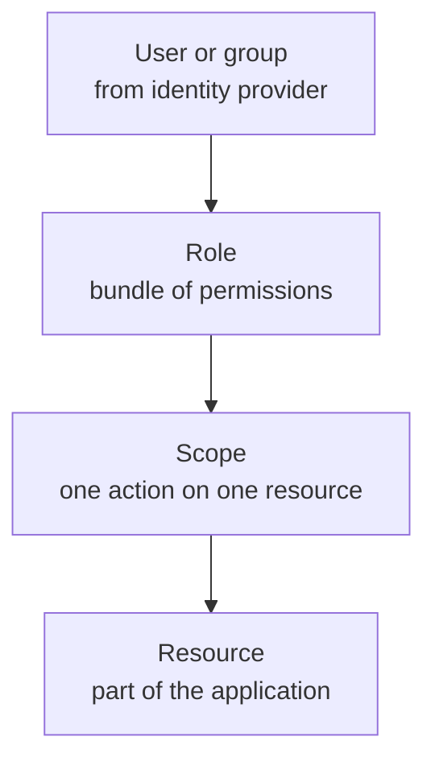
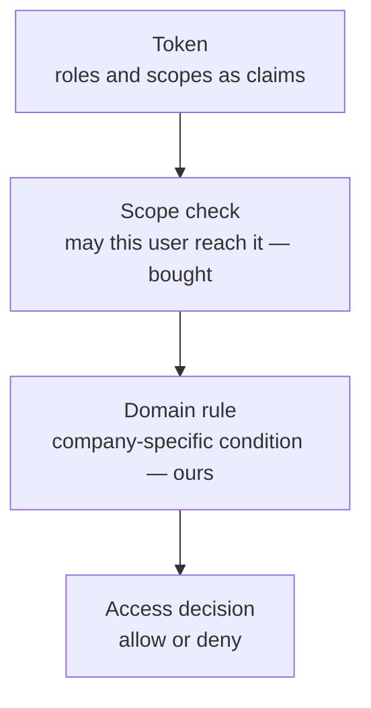

> The design detail behind `§16–17` — identity bought, behind a protocol seam, vendor and topology left open.
> What is here is the provider survey, their licences and a list of things to check in a PoC: material we do
> not want to research twice.
>
> **Implementation state:** the seam stands and a local HMAC is the verifier. No provider was set up, and
> `CLAUDE.md` lists one under what we deliberately do not build. **Not reviewed since it was moved here.**
>
> **9 August:** the second axis below is no longer open — see "Two axes" for the decided topology.

# Identity — the boundary, before any decision

No vendor is chosen here, and no topology either. What is worth fixing now is the seam, because the seam is
what keeps every later option open.

## The one rule

**Identity sits behind a protocol seam, wherever it runs. The engine's domain code receives an OIDC discovery
URL, a client id and a client secret, validates a signed token against JWKS, and holds neither credentials nor
the ability to issue tokens.**

That is the whole architectural commitment, and it is deliberately silent on topology. It costs one plug in
the engine (`oidcc`) and a `behaviour` for the handful of user-management calls the admin screen needs.

## Three levels, so "IAM" does not read as one thing

The word covers three questions with three different owners. Worked through on a TaxVision-shaped example —
an accounting API, an HR API, a frontend, and a user-management API — on 4 August.

| | Question | Owner |
| --- | --- | --- |
| Authentication | who is this | Bought |
| Entitlement | may this person reach the accounting API at all | **Bought** — a role grant, carried as a token claim |
| Domain rule | may they approve an invoice over 50k, may they see salaries outside their own department | Ours |

"Employee X has accounting, employee Y has HR only" is the middle row, and it arrives free with any provider:
grant a role, read one claim. No engine is built for it.

The third row is where the value is, and it is already accounted for — technology notes §13 lists *Permission
engine — own dependency, Oban-style migrations*. **The user-management API is therefore thin**: the employee
list is provider users, granting access is a role grant, inviting someone is a provider endpoint. Thickness
there would mean a second source of truth about who works at the company. It thickens only where the rules are
about our domain, which the provider knows nothing about.

The one part of this worth settling early, because it enters every request path: **how a given API learns the
entitlement** — from the token (no network, fresh to within the token lifetime; right for entitlements), from
its own replica updated by an event when a grant changes (right for rules, and consistent with the
event-driven direction), or by calling a shared authorisation service per request. The third turns several APIs
into a distributed monolith where one outage takes all of them down; prefer the first two.

## The same three levels, as a graph

Added 9 August, from a conversation about how access should scale as roles and resources grow. First, what
is granted — the bought half of the table above, drawn as a hierarchy:

Second, what happens on a request — where the owned row from the table joins in, after the bought check
rather than instead of it:

This is why each kind of change stays cheap. A new part of the application is a new scope in the provider's
config. A new access level is a new role bundling scopes that already exist. Both are configuration, not
code, and neither touches the engine. Only a new company-specific condition — the third row — is code, and
it lands in the permission engine (technology notes §13) alone, isolated from who can authenticate and how.

## Two axes, both now decided

| Axis | State |
| --- | --- |
| Write or buy the provider | ADR 009 (`empowered-house-contextdocs/adr/architecture.md`) decided **not written** |
| Where it runs — in-process module, sidecar, separately deployed application, or the client's own service | **Decided 9 August: sidecar**, with an Elixir wrapper module/process in front of it |

The seam holds in all four positions on the second axis, which is why it could be fixed before that axis
was. It is now fixed by what the wrapper already has to do, independent of which provider gets picked: hold
the protocol-seam behaviour (`lib/pns/auth.ex`), the user profile mirror, and the permission/scope engine
(technology notes §13) — three pieces that need their own process regardless of topology, so running the
bought provider as a sidecar next to that process costs nothing extra. It also keeps the promise that this
API can be called by applications the client didn't build: any OIDC client, ours or someone else's, talks to
the sidecar's discovery endpoint and JWKS the same way — nothing about a third-party caller requires code
here beyond what the seam already commits to.

One interaction to watch, because it is the only place the axes touch: *module* is a packaging choice while the
provider is still bought — an OIDC provider running inside the same release unit. *Module* meaning we implement
OIDC ourselves, for instance on `Boruta`, reopens the first axis. That is a write-or-buy decision wearing the
costume of a packaging decision.

## What that rule keeps open, so none of it has to be decided now

| Later decision | Why the rule protects it |
| --- | --- |
| Which provider — Zitadel, Keycloak, something else | Swappable, and swappable *per client*, not per company |
| A client who already runs their own IdP | Becomes a configuration change, not a project |
| Our own login and signup screens | Independent of the seam; a screen choice, not an architecture one |
| SCIM, directory sync, automatic loss of access when someone leaves | Access token lifetime is the lever, and it is a setting |
| Module, sidecar, separate application, or the client's own service | A packaging decision downstream of the seam |

## Provider options, recorded so they need not be researched again

All licences below permit bundling and redistribution, which matters if the component ships with the project
into a client's environment.

| Candidate | Licence | For | Against |
| --- | --- | --- | --- |
| **Zitadel** (Go) | Apache 2.0 | Declarative bootstrap, organizations model, SCIM v2, login shipped as a separate deployable app, light to bundle | Smaller ecosystem and hiring pool |
| **Keycloak** (JVM) | Apache 2.0 | Most battle-tested against corporate IdP quirks, identity brokering, LDAP/AD federation, widest familiarity | Heavy to bundle, upgrades painful, no built-in SCIM server |
| Authentik (Python) | MIT core | Flexible flows, SCIM inbound and outbound | Weaker multi-tenancy, centre of gravity is self-hosters rather than B2B |
| BoxyHQ SAML Jackson | Apache 2.0 | Surgical: SAML-to-OIDC bridge, directory sync, admin portal for the client's IT — the paid part of WorkOS | Not a provider; only relevant if we keep our own auth |
| SuperTokens | Apache 2.0 | OIDC plus multi-tenancy | Reaches SAML through Jackson anyway |
| Ory (Hydra, Kratos) | Apache 2.0 | Strong protocol implementation, API-first | **Ruled out** — no SAML SP, so enterprise SSO fails |
| `Boruta` (Elixir) | — | An in-process OIDC provider, if the seam is ever wanted without a second runtime | Protocol only; no SAML broker, no SCIM, no admin portal. Reopens write-or-buy |

Two off the list, with reasons, so they do not get re-proposed:

**WorkOS** fails on model rather than price. It cannot ship into a deployment that runs in a client's own
environment, and its per-connection pricing lands in cost of goods per client rather than as a fixed tool cost
— wrong shape when every client is one enterprise connection.

**FusionAuth** is source-available with a free community edition, not open source. Worth remembering only
because its pricing is not per connection, so it is the commercial fallback if self-hosting is rejected.

Non-obvious things to verify in a PoC rather than trust from documentation: Zitadel's SCIM v2 coverage, how far
its login application can be restyled, `zitadel_api`'s API-generation coverage (generated gRPC clients lag API
generations; REST via the gRPC gateway is the fallback), and which Google Workspace and Entra ID licence tiers
gate automatic provisioning on the client's side.

Added 9 August, from the concrete requirement this client-shaped example surfaced: **not** a consumer social
login (Apple among them) — the actual shape is a client's existing workforce identity, the thing already
covered by "a client who already runs their own IdP" above. Concretely: federate into a client's Google
Workspace domain or Microsoft Entra ID tenant so their staff use the sign-in they already have, broker a
client's own OIDC/SAML IdP the same way for whoever runs neither, and fall back to the provider's own
email/password store for a client with no workforce IdP at all. Both Zitadel and Keycloak do this as identity
brokering — ordinary configuration, not code — so the thing to verify in a PoC is provisioning-tier gating
(the Google Workspace / Entra ID licence question already listed above), not whether the feature exists.
Separately: whether locking or disabling a user forces immediate re-authentication — a revoked session, not
just an access token left valid until its TTL expires.

## PoC findings, 9 August

`docker-compose.identity.yml` runs Zitadel as the sidecar; `PNS.Auth.OidcVerifier`
(`lib/pns/auth.ex`) is the wrapper, validating a bearer token's signature against the sidecar's JWKS via
`Oidcc.Token.validate_jwt/3`. Not the active `PNS.Auth.Verifier` — see that module's moduledoc for why. Run
against a real, freshly-booted instance (`priv/poc/identity_smoke_test.exs`):

- **Client credentials belong to a machine *user*, not a project *application*, and that is fixed, not a
  config gap.** An `apps/api` or `apps/oidc` client with `grantTypes: [CLIENT_CREDENTIALS]` gets
  `invalid_client — client not found` at `/oauth/v2/token` every time — confirmed via the server log
  (`Errors.User.NotFound`), not just the HTTP response, and unchanged by adding a compliant `redirect_uri` or
  `accessTokenType: OIDC_TOKEN_TYPE_JWT` to the app. The client actually has to be a Zitadel machine user's own
  generated secret (`PUT /management/v1/users/{id}/secret`).
- **Which is why that token is not what the seam expects.** A machine user's `client_credentials` access token
  comes back as an encrypted JWE (five dot-separated segments) always — there is no app-level setting that
  changes it, because no app is involved in that request at all. `OidcVerifier` correctly rejects it with
  `:no_matching_key`. The `id_token` from the same response, in contrast, is an ordinary signed RS256 JWT and
  verifies cleanly into a `PNS.Auth.Actor`. **For service-to-service calls specifically**, this means the
  resource side needs `/oauth/v2/introspect` — the network-per-request route §"Three levels" above already
  argues against for ordinary requests, accepted here because it is the only route this shape offers.
- **No `roles` claim shows up unasked.** Matches the table above — a role has to be granted and the right scope
  requested before it appears; nothing arrives "free" without both.
- **Fixed, 10 August: browser login now works end to end.** `docker-compose.identity.yml` runs a second
  container (`ghcr.io/zitadel/zitadel-login`, the login screens Zitadel v3+ ships separately from the core
  API) and a Traefik in front of both, path-routing `/ui/v2/login*` to it and everything else to the core
  (`identity-poc-traefik-dynamic.yml`) — the two only work together behind one origin, because the API
  redirects a browser to a same-origin path rather than a different port. Bootstrapping needs a *second*
  machine user + PAT beyond the admin one (`ZITADEL_FIRSTINSTANCE_ORG_LOGINCLIENT_*`,
  `ZITADEL_FIRSTINSTANCE_LOGINCLIENTPATPATH`) for the login container to call the API with. Run through a real
  browser: authorize → login form → password → redirect back with a code → exchanged for a token →
  `PNS.Auth.OidcVerifier` verifies the resulting `id_token` into a `PNS.Auth.Actor`, same as the machine-user
  case above. One quirk worth recording so it does not look like a bug next time: the human user's
  `loginName` was not the plain `admin` given to `ZITADEL_FIRSTINSTANCE_ORG_HUMAN_USERNAME` — Zitadel appended
  the org's domain, so the working login was `admin@zitadel.localhost`.
- **The core's own `ready` healthcheck stopped agreeing with `/debug/healthz` once this login-client bootstrap
  was added.** `/debug/healthz` answers 200 the whole time (checked directly, from inside the container); the
  `zitadel ready` CLI subcommand used in the compose healthcheck reports not-ready indefinitely. Not chased
  further — `depends_on` for the other containers does not gate on it.
- **Bootstrapping needs no browser.** `ZITADEL_FIRSTINSTANCE_ORG_MACHINE_MACHINE_USERNAME` +
  `ZITADEL_FIRSTINSTANCE_PATPATH` write a working Management API token to a bind-mounted file on first boot, so
  the whole loop above — project, app, machine secret, token, verify — is scriptable end to end from a cold
  `docker compose up`. This is what makes the space in `priv/poc/` a real test bed rather than a stub that
  waits on someone clicking through a console.

**Decided 9 August, from the frontend's planned users-and-access screen:** that screen calls *our* API, never
the sidecar's, even though the sidecar's own Management API already does everything the screen needs (this PoC
used it directly: create project, create app, grant a machine user's secret, all plain REST). A thin proxy in
the wrapper costs real code the direct route would not — but the direct route means the frontend knows
Zitadel's request shapes, and swapping providers becomes a frontend rewrite instead of the one-line config
change §"Two axes" already promises. Not yet built.

## Simplest start

Run the provider as a sidecar, wire the plug, and move on. Zitadel is the current best guess on bundling
ergonomics and Keycloak on breadth of IdP compatibility — but under the rule above, that guess is cheap to be
wrong about, which is exactly why the vendor does not need settling today even though the topology now is.

What breaks the rule, and therefore should not happen: a credential store reachable from the engine's domain
code, domain code minting its own tokens, or any vendor name in the engine's configuration schema.

## One thing worth fixing now

[Technology notes §13](technology-notes.md) lists *Users and sessions —
`phx.gen.auth`, generated*. Read literally that is a credential store inside the engine, which contradicts
identity being separate and produces two answers to whether a person still works at the company. It should
say either "user profile mirror, no credentials, keyed by the identity subject" or nothing.

## Not decided

Vendor, login screen route, deprovisioning mechanism, who operates the instance. Also
ADR 009 (`empowered-house-contextdocs/adr/architecture.md`) line 248 still says `WorkOS wrapped`; that becomes
wrong if the deployment ships into the client's environment, but it can be corrected whenever the ADR is next
touched rather than on its own.

Reasoning behind all of the above is in the 4 August conversation; it does not need to be repeated here until
something is actually being decided.
