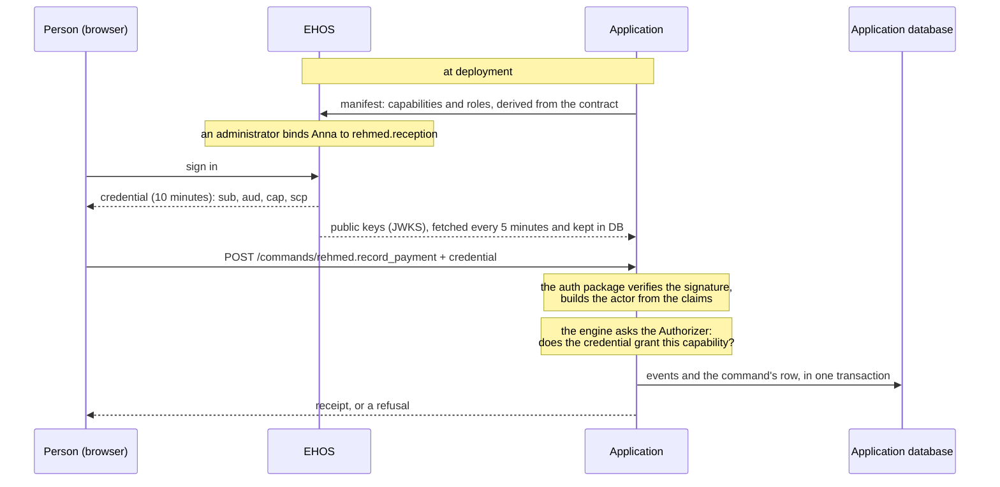
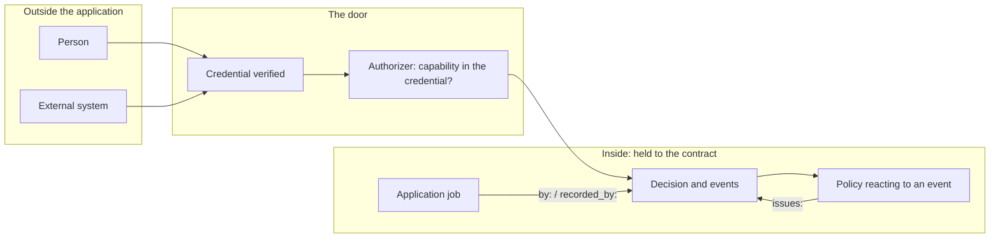

# Authorization

How an application built on `eh_os_contract` decides who may issue a command, ask a query or
record an event. The design is recorded in `docs/adr/contract-v2.md` (§11, §16 D10 and D14, and the
dated note of 26 September 2026); this page explains how the pieces fit, and what is built today.

## The approach in one sentence

**The contract says what can be done and which role may do it; EHOS decides which people get which
roles; the application checks it on every call, locally, without asking EHOS.**

Three places, each answering its own question:

| Where | Question | Example |
| --- | --- | --- |
| The contract | What can be done, and by which role? | `command :record_payment, by: :reception` |
| EHOS | Which person holds which role, where? | Anna is bound to `rehmed.reception` in `rehmed/production`, for clinic 7 |
| The application | Does this caller's credential allow this call? | Anna's credential lists `rehmed.record_payment` |

The model is role-based access control flattened into capabilities, the shape Kubernetes RBAC and
cloud IAM use: roles are bound to people, and the credential carries the union of the capabilities
those roles grant. The application never learns which roles a person has, only what their credential
allows.

## Names: capabilities and roles

Names are derived from the contract, never written by hand, so the list EHOS grants from cannot drift
from the code (`EhOsContract.Model.capabilities/1`):

- a **capability** per command, per query and per recorded event a person may use: `<domain>.<name>`,
  e.g. `rehmed.record_payment`, `rehmed.open_visits_for_clinic`, `rehmed.patient_arrived`, where
  `<domain>` is the domain's `name:`;
- a **role** per `:human` actor of the domain: `<domain>.<actor>`, e.g. `rehmed.reception`. A role
  grants the capabilities of every declaration whose `by:` or `recorded_by:` names that actor.

**Only what a person may do is a capability.** A declaration whose `by:` or `recorded_by:` names no
`:human` actor — a command only a policy issues, an event only an integration records — has none, so
no credential can be granted it, even by mistake; the application's own `:system` actor reaches it
without a credential.

Because a capability is `<domain>.<name>`, a command, query or recorded event name is unique across the
whole application, which the compiler checks (D14).

## The flow, end to end



1. **Deployment.** The application sends EHOS a manifest with its capabilities and roles, derived from
   its contracts, beside what its `ehos.yaml` says it needs: `ehos.manifest/v2`, which
   `mix eh_os_contract.manifest --output ehos.manifest.json` in `eh_os_contract_auth` writes.
2. **Binding.** An EHOS administrator binds a person to a role, per application and environment,
   optionally with scope values ("clinic 7").
3. **Sign-in.** The person signs in to EHOS and receives a credential: a JWT signed with Ed25519, valid
   for ten minutes, for one application and environment (`aud`). It carries `sub` (who), `cap` (every
   capability of every role bound to them there) and `scp` (the values of scoped capabilities).
4. **Keys.** The application keeps EHOS's public keys in its own database and refreshes them every five
   minutes, so it verifies credentials without calling EHOS, and keeps working while EHOS is down.
5. **The call.** The credential arrives with the request. The auth package verifies it and builds an
   `EhOsContract.Actor`; the engine asks the `EhOsContract.Authorizer` whether that actor may make this
   call; only then does anything decide or write.

## The door: which calls are asked

**The check stands at the application's door.** What matters is where a call comes from, not what
kind of actor makes it.



| Where the call comes from | Actor | What checks it |
| --- | --- | --- |
| A person, with a credential | `Actor.credential(sub, cap, scp)` | the `Authorizer`: the capability is in the credential |
| An external system, with its own credential | `Actor.credential/3` | the same, once EHOS issues credentials to systems |
| A policy reacting to an event | built by the engine | the contract: the policy's `issues:` names the command |
| The application's own code (a job, an import) | `Actor.system(:name)` | the contract: the actor is `:system` in the domain and named in `by:` or `recorded_by:` |

The application's own code is not asked of the `Authorizer`, for three reasons: the application would
be asking itself; EHOS issues no credential to a job; and a policy runs in the transaction of the
command that set it off, so a refusal there would fail a person's command for a reason that is not
theirs. Its permission was given when the contract said `issues:` or `by:` and a reviewer approved
it; the compiler and dispatch hold it to that. A `:system` actor can do only what the contract names
it for: `Actor.system(:nightly_import)` cannot record a payment unless a declaration says
`by: :nightly_import`, and a person's actor cannot be passed off as one, because the domain must
declare the actor `:system`.

A person never *is* the application's code, so a person always comes through the door.

## The Authorizer

```elixir
config :eh_os_contract, authorizer: MyApp.Authorizer
```

One callback:

```elixir
@callback authorize(EhOsContract.Actor.t(), EhOsContract.Authorizer.Request.t()) ::
            :ok | {:error, reason :: atom()}
```

The request names the kind (`:command` or `:query`), the capability, the contract and its version, and
for a scoped query the dimension and the value asked for (`{"clinic_id", "7"}`).

**The decision is `EhOsContract.Authorizer.check/2`**, and it reads nothing but the actor and the
request:

| Result | When |
| --- | --- |
| `:ok` | the credential grants the capability, and a scoped value is among its values |
| `{:error, :missing_capability}` | the capability is not in `cap` |
| `{:error, :unscoped_grant}` | the capability is scoped and `scp` carries no values for it: empty is not "all" |
| `{:error, :outside_scope}` | the value asked for is not among the granted values |

`EhOsContract.Authorizer.Default`, used when nothing is configured, is `check/2` alone and records
nothing. `EhOsContract.Auth`, in the package `eh_os_contract_auth` for EHOS credentials, calls
`check/2` and records a row for every decision in `eh_os_contract_auth_decisions`.

**An implementation may narrow what a credential grants, never widen it.** After an `:ok`, the engine
runs `check/2` again from the actor and raises `EhOsContract.Authorizer.WidenedError` if it refuses.
A defect in an implementation therefore fails loudly instead of letting a call through, and grants
must travel in the credential, as EHOS issues them.

An implementation that adds a rule of its own, for instance refusing suspended accounts:

```elixir
defmodule MyApp.Authorizer do
  @behaviour EhOsContract.Authorizer

  @impl true
  def authorize(actor, request) do
    if MyApp.Accounts.suspended?(actor.subject),
      do: {:error, :suspended},
      else: EhOsContract.Authorizer.check(actor, request)
  end
end
```

## Scope: narrowing a query to rows

A query may be scoped by one field of its read model (D10):

```elixir
# in the domain
actor :reception, :human, "Recepcja", scope: [:clinic_id]

# in the contract
query :open_visits_for_clinic, "Otwarte wizyty w przychodni",
  reads: :open_visits, by: [:reception], scope: :clinic_id do
  param :clinic_id, :id
end
```

EHOS binds the role with values, and the credential carries them:

```json
{
  "cap": ["rehmed.open_visits_for_clinic"],
  "scp": {"rehmed.open_visits_for_clinic": {"clinic_id": ["7"]}}
}
```

- **Before the implementation runs**, the value of the scope parameter is checked against the
  granted values. Asking for clinic 12 with a grant for clinic 7 is `{:error, :outside_scope}`, and the
  query's code never runs.
- **A scoped capability without values is refused** (`:unscoped_grant`): the check fails closed.
- **After the implementation answers**, every row's scope field is checked against the grant again.
  A row outside it raises `EhOsContract.Authorizer.OutsideScopeError` and no row is returned, so a
  wrong `where` cannot hand one clinic another clinic's rows.
- Values are compared as the strings the credential carries, so a granted value that is not of the
  field's type matches nothing instead of failing a cast.
- The application's own `:system` actor named in the query's `by:` is not narrowed.

`scope` is one field compared for equality. "Only the visits I handled" or a rule over several fields
stays in the application's code.

## Recording an event

`EhOsContract.record/3` appends an event the contract declares `recorded_by:`, without a command: an
observation or an integration's answer (D6). Its capability is `<domain>.<event>`, with the roles of
the actors in `recorded_by:`, and a credential is asked of the `Authorizer` for it as for a command —
reception marking that the patient arrived needs `rehmed.patient_arrived`. A `:system` actor the
event names records it without a credential. `EhOsContract.Plug` serves it as
`POST <mount>/records/<capability>` with the event's fields as the body.

Until 28 September 2026 (stage E9) a credential was refused with `{:error, :not_grantable}`, because no
capability named a recording; the name `<domain>.<event>` was decided on 27 September.

## What is written

| Outcome | Event log | `eh_os_contract_commands` | Auth package's table, for a call with a credential |
| --- | --- | --- | --- |
| Refused by the Authorizer | nothing | nothing | a `refused` row, with the reason |
| Accepted | the events | an `accepted` row | an `allowed` row |
| Rejected on an invariant | nothing | a `rejected` row | an `allowed` row |
| Failed in code | nothing (rolled back) | a `failed` row | an `allowed` row |

A refusal leaves nothing in the engine's tables; the row that records it belongs to the
`Authorizer`'s implementation. Queries write nothing to the log: a read is not a fact, but a query
with a credential has its decision row like a command.

The two rows of an accepted command are two facts, not one written twice: the auth package's row
records that the credential allowed the call, `eh_os_contract_commands` what became of the command.
The engine asks the `Authorizer` before its own transaction, so a caller that wraps `dispatch/3` in a
transaction of its own and rolls it back rolls the decision row back too; `EhOsContract.Plug` never
does.

## Over HTTP

`EhOsContract.Plug` serves the commands, recordings and queries of the contracts it is given, under
their capabilities:

```elixir
# in the host's router, after the plug that verifies the credential
forward "/api", EhOsContract.Plug, contracts: [Rehmed.Contracts.VisitSettlement]
```

```text
POST /api/commands/rehmed.record_payment     {"visit_id": "w-1", "method": "card", "amount": 20000}
GET  /api/queries/rehmed.open_visits_for_clinic?clinic_id=7
```

It authenticates nobody. The actor is `conn.assigns.eh_os_contract_actor`, which the plug in front of
it builds from a credential it verified; without one, the answer is 401. A `:system` actor never comes
over HTTP and is refused the same way.

| Outcome | Status |
| --- | --- |
| accepted, or a query answered | 200 |
| rejected on an invariant, or fields that do not fit | 422 |
| refused (`missing_capability`, `outside_scope`, …) | 403 |
| no credential's actor | 401 |
| conflict, or an idempotency key the same actor used for another command | 409 |
| no such capability | 404 |

No response body carries a value the caller did not send: a problem names the field, a refusal its
reason. **Whether the caller may is answered first:** a request whose body or fields do not fit is
asked of the `Authorizer` all the same, so a caller without the capability gets 403 and learns nothing
about the declaration's fields, and every request is one decision, recorded by the auth package.

## Another door

The plug is one door onto `EhOsContract.call/3`, and a host's other doors — a form, a job that carries a
person's credential — call it the same way: the capability's name, the data as it was sent, the
credential's actor.

```elixir
EhOsContract.call(
  {:command, "rehmed.record_payment"},
  %{"visit_id" => "w-1", "method" => "card", "amount" => 20000},
  actor: actor, idempotency_key: "req-81"
)
#=> {:ok, %EhOsContract.Receipt{...}}
```

It asks the `Authorizer` before it says what is wrong with what was sent, as the plug does, and answers
as `dispatch/3`, `record/3` or `query/3` would, or `{:error, :not_found}` for a capability the contracts it
serves (`contracts:`, every registered one by default) do not declare as that kind, `{:error, :no_actor}`
without a credential's actor, and, once the caller may, `{:error, :not_an_object}` or
`{:error, :correlation_id_is_not_a_uuid}`. A door that builds structs itself goes around that order, which
is why the plug no longer does.

## Calling it from code

```elixir
actor =
  EhOsContract.Actor.credential("u-81", ["rehmed.record_payment"])

EhOsContract.dispatch(Rehmed.Contracts.VisitSettlement,
  %RecordPayment{visit_id: "w-1", method: :card, amount: 20_000},
  actor: actor, idempotency_key: "req-81")
#=> {:ok, %EhOsContract.Receipt{...}}

# the application's own job, acting as a :system actor of its domain
EhOsContract.dispatch(MyApp.Contracts.Ledger, %Deposit{account_id: "a-1", amount: 100},
  actor: EhOsContract.Actor.system(:nightly_import))
#=> {:ok, ...} when the command's by: names :nightly_import, else {:error, :not_declared}
```

`Actor.credential/3` verifies nothing. Build it only from a credential that was verified, which in a
host means the auth package's plug.

**An idempotency key belongs to the actor who sent it**: to the credential's subject, or to the
`:system` actor's name. Two actors with one key are two commands, and neither sees the other's receipt.
What that asks of a host:

- a retry has to come from the same subject: if EHOS gives a user another `sub` between the first try
  and the retry, the retry is a new command and runs;
- everything that shares one credential, or runs as one `:system` actor, shares one key space: two jobs
  importing as `:nightly_import` both sending `"row-1"` are one command, so give each job's keys a
  prefix of its own.

## How strong this is

It is the standard, well-understood level: the same as an application validating Auth0, Keycloak or
Entra ID tokens. Signed short-lived tokens (Ed25519, ten minutes) verified locally against published
keys, rotation by `kid`, one audience per application and environment, roles flattened into
capabilities, failing closed, and a record of every decision.

Two things are stronger than in a typical application. The check sits in one place, dispatch, rather
than in every controller, which closes the most common web weakness (OWASP A01, broken access
control): a command without the capability does not reach its decision, whichever way it came. And
a query's rows are checked a second time against the grant.

Known limits, accepted deliberately:

- A removed role keeps working until the credential expires, at most ten minutes, as with any JWT
  without a revocation list.
- A stolen credential works until it expires. Binding tokens to a client (DPoP, mutual TLS) is a
  higher, banking-grade level, and would be EHOS's decision.
- A key removed from EHOS's set is trusted until the next refresh, at most five minutes.
- `scope` is one field and equality; richer row rules stay in application code.
- The audit rows are not tamper-evident.
- How a frontend obtains a credential for a signed-in user is EHOS's to design, and the whole chain is
  as strong as that flow; the standard is OpenID Connect's authorization code flow with PKCE.

## What is built

| Part | Status |
| --- | --- |
| Capability and role names derived from the contract | built (E4) |
| `EhOsContract.Actor`, `EhOsContract.Authorizer` with `check/2` and the default | built (E6) |
| Authorization in `dispatch/3`, `query/3` and `record/3`, scope checks, the row check | built (E6) |
| `EhOsContract.Plug` | built (E6) |
| Verifying EHOS credentials, keeping keys, the audit row, the bearer-token plug, the test helper | built (EA), package [`eh_os_contract_auth`](https://github.com/EmpoweredHouse/eh-os-contract/tree/main/packages/eh_os_contract_auth) |
| The manifest EHOS reads, `ehos.manifest/v2` from `ehos.yaml` and the contracts | built (E10, EH), package [`eh_os_contract_auth`](https://github.com/EmpoweredHouse/eh-os-contract/tree/main/packages/eh_os_contract_auth) |
| Sign-in for a frontend's users | EHOS, not designed yet |
